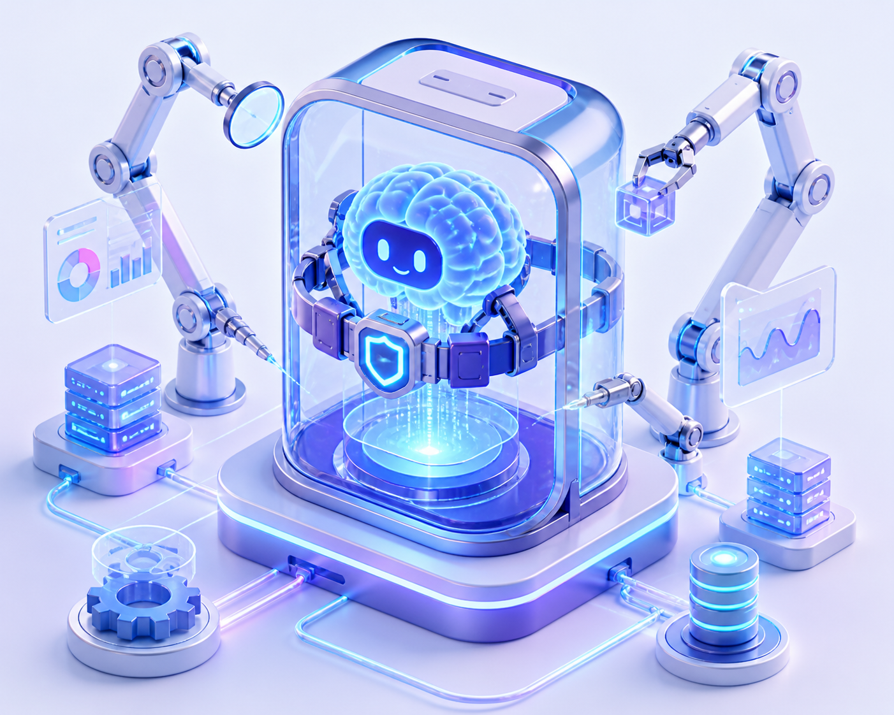

AI 뉴스를 보다 보면 최근 **"하네스(Harness)"** 혹은 **"에이전트 하네스(Agent Harness)"**라는 생소한 단어가 자주 등장합니다.

원래 '하네스'는 강아지 산책용 가슴줄이나 암벽 등반용 안전벨트, 혹은 말의 고삐와 마구를 뜻하는데요. 도대체 소프트웨어와 AI 분야에서 하네스는 무엇이고, 왜 에이전트 시스템에서 필수적인 요소로 불릴까요?

어려운 전문 용어 대신 일상의 비유와 대표적인 실전 예시로 알기 쉽게 정리해 보았습니다.

---

## 1. 순수한 LLM은 '유리병 속의 천재 두뇌'다

ChatGPT나 Claude 같은 최신 대규모 언어 모델(LLM)은 엄청나게 똑똑합니다. 온갖 지식을 꿰고 있고, 복잡한 코드를 짜고, 논리적인 추론도 훌륭하게 해냅니다.

하지만 **순수한 LLM 모델 자체만 떼어놓고 보면 치명적인 한계**가 있습니다.

- **손발이 없습니다**: 스스로 파일을 열거나, 인터넷을 검색하거나, 터미널 명령어를 입력할 수 없습니다. 오직 텍스트를 입력받아 텍스트로 답할 뿐입니다.
- **기억이 단절됩니다**: 질문이 끝나고 창을 닫으면 이전 대화나 작업 상태를 기억하지 못합니다.
- **실수를 수습하지 못합니다**: 코드를 실행하다 오류가 나도, 누군가 에러 로그를 다시 쥐어주지 않으면 스스로 고칠 수 없습니다.
- **안전장치가 없습니다**: 모델이 엉뚱한 착각(환각)을 하거나 위험한 명령을 내뱉어도 스스로 멈추지 못합니다.

즉, 아무리 뛰어난 모델이라도 혼자 두면 **"말은 유창하지만 혼자서는 아무것도 실행할 수 없는 유리병 속의 두뇌"**와 같습니다.

---

## 2. 하네스(Harness): 두뇌에 손발과 안전벨트를 달아주는 틀

바로 이 유리병 속 천재 두뇌에게 **손과 발, 기억 장치, 그리고 안전벨트를 장착해 실제로 일할 수 있는 완벽한 일꾼으로 만들어주는 운영 틀**을 **하네스(Harness)**라고 부릅니다.

말을 길들여 마차를 끌게 하려면 고삐와 안장(Harness)이 필요하듯, AI 모델이 실제 세상의 도구를 쥐고 복잡한 업무를 끝마칠 수 있도록 통제하고 지원하는 소프트웨어 환경입니다.

_유리병 속 똑똑한 두뇌(LLM)에 로봇 팔(도구), 데이터베이스(기억), 그리고 안전벨트(가드레일)를 달아주는 하네스의 구조_

---

## 3. 하네스는 구체적으로 무슨 일을 할까?

하네스가 수행하는 핵심 역할은 크게 네 가지입니다.

1. **손발 달아주기 (Tool & Sandbox Execution)**  
   AI가 "이 파일을 수정해야 해"라고 판단하면, 하네스가 실제로 파일 시스템에 접근해 코드를 바꾸거나 안전한 격리 환경(샌드박스)에서 프로그램을 실행하고 그 결과를 다시 AI에게 건네줍니다.
2. **기억과 맥락 관리 (Context & Memory)**  
   이전 단계에서 무슨 작업을 했는지, 어떤 파일들을 읽었는지 작업 기록과 세션을 체계적으로 관리해 AI가 맥락을 잃지 않고 긴 호흡의 작업을 이어가도록 돕습니다.
3. **실패하면 다시 시도하기 (Error Recovery & Loop)**  
   작업 도중 오류가 발생하면 하네스가 "이 에러가 났으니 다른 방식으로 시도해 봐"라고 피드백 루프를 돌려주며, 작업이 완료될 때까지 과정을 자율적으로 조율합니다.
4. **선을 넘지 않게 막기 (Guardrails & Permissions)**  
   AI가 실수로 중요 시스템 파일을 삭제하거나 허가되지 않은 외부 사이트에 접근하려 할 때, 하네스가 중간에서 권한을 검사하고 위험한 동작을 사전에 차단합니다.

---

## 4. 실전에서 널리 쓰이는 유명한 하네스 예시들

실제 AI 개발 생태계에서 어떤 것들이 하네스 역할을 하고 있을까요? 대표적인 예시들입니다.

### ① 랭그래프 (LangGraph / LangChain)
가장 대중적인 오픈소스 에이전트 하네스입니다. AI가 질문을 받았을 때 '웹 검색을 먼저 할지', 'DB를 뒤질지', '코드를 짤지'를 다이어그램(그래프) 형태로 설계해 두고, 각 단계마다 상태(State)와 도구 실행을 촘촘하게 통제합니다.

### ② 크루AI (CrewAI) & 오토젠 (Microsoft AutoGen)
여러 AI가 팀을 이뤄 협업하도록 묶어주는 **멀티 에이전트 하네스**입니다. 예를 들어 '기획자 AI', '개발자 AI', '리뷰어 AI'를 정의해 두면, 하네스가 서로 대화를 주고받게 하고 역할을 넘겨가며 하나의 프로젝트를 완성하게 만듭니다.

### ③ 키미 호스티드 에이전트 하네스 (Kimi Hosted Agent)
문샷 AI가 기업용으로 정식 출시한 클라우드 관리형 하네스입니다. 장시간 걸리는 복잡한 작업을 안전한 클라우드 샌드박스에서 돌리고, 도중에 서버에 문제가 생겨도 하네스가 이전 상태(체크포인트)를 기억해 자동으로 복구하고 이어서 작업을 마칩니다.

### ④ 클로드 코드 (Claude Code) & 커서 (Cursor)
개발자 생태계에서 가장 각광받는 **코딩 전용 하네스**입니다. AI 두뇌 뒤에서 로컬 터미널 명령어를 치고, git diff를 검사하고, 코드를 직접 고친 뒤 테스트가 통과하는지 끝까지 확인하는 실전 개발용 하네스입니다.

---

## 💡 잠깐, 코덱스(Codex)도 하네스일까요?

코딩 AI를 공부하다 보면 가장 많이 헷갈리는 질문 중 하나입니다.

결론부터 말하면, **원래의 OpenAI Codex 자체는 하네스가 아니라 '순수한 두뇌(LLM 모델)'**입니다.

- **코덱스(Codex)**: GPT-3를 수많은 프로그래밍 코드로 학습시켜 탄생한 **코드 특화 언어 모델**입니다. 즉, "다음에 올 코드를 기가 막히게 예측해서 써내는 똑똑한 뇌"입니다.
- **코파일럿(GitHub Copilot) / 에디터**: 그 코덱스 두뇌를 가져다가 VS Code 에디터 창 안에 심고, 파일 내용을 읽어다 프롬프트로 전달하고, 탭 키를 누르면 코드를 붙여 넣어 주는 **실제 도구 틀(하네스)**입니다.

비유하자면 **코덱스는 뛰어난 F1 레이서(두뇌)**이고, **하네스는 레이서가 타고 달리는 경주차와 운전대, 페달, 안전벨트(실행 환경)**입니다. 레이서가 아무리 훌륭해도 자동차(하네스)가 없으면 경주를 달릴 수 없는 것과 같습니다.

*(참고: 최근에는 모델 개발사들이 모델뿐만 아니라 CLI나 에이전트 실행 환경까지 함께 묶어 제공하는 추세라 둘의 경계가 점차 가까워지고 있습니다.)*

---

## 정리하며

- **LLM(모델)**이 생각하는 **'두뇌'**라면,
- **하네스(Harness)**는 그 두뇌가 안전하게 현실 세계의 일을 처리할 수 있게 감싸주는 **'몸체이자 운영체제(OS)'**입니다.

최근 AI 기술의 흐름이 단순한 '질의응답 챗봇'을 넘어, 스스로 계획을 세우고 도구를 써서 일을 완수하는 **'자율 에이전트(Autonomous Agent)'**로 넘어가면서 하네스의 중요성은 점점 더 커지고 있습니다.

앞으로 복잡한 자동화 파이프라인이나 자체 에이전트를 만들 때 "이 하네스를 어떻게 설계할 것인가"가 AI의 실제 성능을 좌우하는 핵심 열쇠가 될 것입니다.
