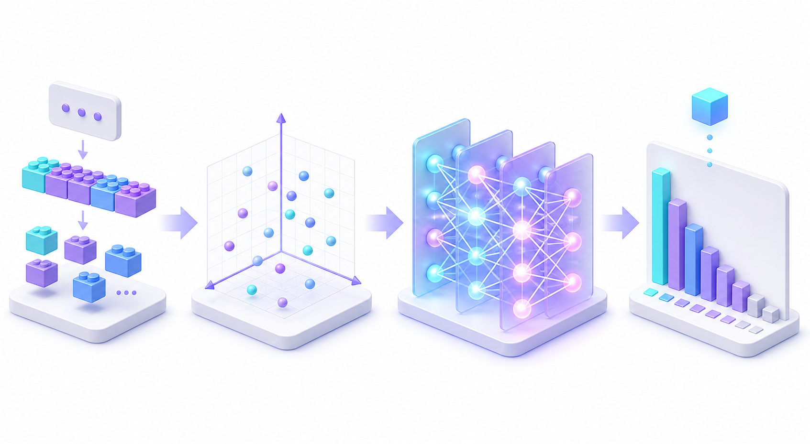

ChatGPT나 Claude 같은 AI와 대화하다 보면 가끔 신기합니다. 어떻게 질문을 듣자마자 생각을 거쳐 저렇게 유창하게 다음 말을 이어가는 걸까요?

흔히 AI가 인간처럼 '생각'을 하고 글을 쓴다고 생각하지만, 사실 AI의 머릿속에서는 아주 정밀한 **"4단계 레고 블록 조립과 단어 맞히기 게임"**이 벌어지고 있습니다.

복잡한 수학 공식 대신, **일상의 친숙한 비유로 AI가 글을 읽고 쓰는 전체 원리**를 알기 쉽게 풀어보겠습니다.

---

## 전체 과정 1분 요약: AI 머릿속의 4단계


_AI가 문장을 처리하는 4단계 흐름: ① 레고 블록 쪼개기 → ② 성향 점수표 붙이기 → ③ 단어들끼리 명함 교환하기 → ④ 다음 단어 인기투표_

1. **토큰화 (Tokenization)**: 문장을 알록달록한 **'레고 블록(토큰)'**으로 쪼갭니다.
2. **임베딩 (Embedding)**: 각 레고 블록에 수천 가지 **'성향 점수표(좌표)'**를 붙여줍니다.
3. **어텐션 (Attention)**: 단어들끼리 **'명함을 교환'**하며 주변 단어들과 문맥을 맞춥니다.
4. **로짓 & 소프트맥스 (Logits & Softmax)**: 사전에 있는 20만 개 단어를 두고 **'다음 단어 인기투표'**를 벌여 하나를 고릅니다.

이 4단계를 차례대로 들여다보겠습니다.

---

## 1단계. 토큰화: 문장을 '레고 블록'으로 쪼개기

컴퓨터는 한글이나 영어를 전혀 모릅니다. 오직 **숫자**만 압니다. 그래서 AI에게 글을 주면 가장 먼저 문장을 작은 조각으로 분해한 뒤 고유 번호를 매깁니다. 이 조각을 **토큰(Token)**이라고 합니다.

### 왜 '단어'가 아니라 '조각'으로 쪼갤까요?
우리가 어릴 때 레고 블록을 생각해보세요:
- 집 모양 완성품을 통째로 사려면 상자가 수만 개나 필요합니다.
- 대신 **기본 벽돌 몇 개만 있으면 어떤 모양의 집이든 다 조립**할 수 있죠.

AI도 똑같습니다. 세상의 모든 단어를 다 외우려면 사전이 터져버리기 때문에, 자주 쓰는 말은 큰 블록으로 두고(`인공지능`), 생소한 단어나 오타는 작은 블록들(`챗` + `봇` + `이`)로 쪼개서 조립합니다.

> 💡 **한 줄 팁**: 영어는 단어 단위 블록이 많아서 토큰을 적게 먹고, 한국어는 글자당 조각이 더 잘게 쪼개져서 토큰을 2~3배 더 많이 씁니다. API 요금이 토큰 수대로 나가는 이유가 여기에 있습니다!

### 💡 짝꿍 필수 개념: 컨텍스트 윈도우 (Context Window)
토큰을 이해했다면 반드시 세트로 따라오는 개념이 바로 **컨텍스트 윈도우(Context Window)**입니다.
- **일상 비유**: 시험 볼 때 책상 위에 한 번에 펼쳐둘 수 있는 **'책상의 넓이'**입니다. 책상이 좁으면 교과서 1권도 버겁지만, 책상이 운동장만큼 넓으면 참고서 10권을 쫙 펼쳐놓고 보면서 문제를 풀 수 있죠.
- **핵심 원리**: AI가 한 번의 대화나 작업에서 **동시에 머릿속에 올려놓고 기억할 수 있는 최대 토큰 용량**입니다. 내가 보낸 질문 + 지금까지의 이전 대화 + 참고 문서 + AI가 써야 할 답변까지 전부 합쳐서 이 '기억 공간(책상)' 안에 들어가야 합니다. (예: Claude 3.7의 200k 토큰은 책 500페이지 분량을 머릿속에 한꺼번에 쫙 펼쳐놓고 대화할 수 있는 크기)
- **실무에서 왜 중요할까?**: 대화가 계속 이어지거나 참고 문서가 너무 길어져서 이 '책상 크기'를 초과하면, AI는 **가장 오래된 대화부터 책상 밖으로 밀려나서 잊어버리게** 됩니다.

---

## 2단계. 임베딩: 단어에 '성향 점수표' 붙여주기

토큰으로 쪼개어 번호표(`[102, 5402, ...]`)를 붙였지만, 아직 컴퓨터는 이 단어가 뭘 뜻하는지 모릅니다. 102번과 103번이 번호가 가깝다고 해서 뜻이 비슷한 건 아니니까요.

그래서 AI는 각 단어마다 **수천 가지 항목의 '상세 성향 점수표'**를 만들어 줍니다. 이를 **임베딩(Embedding)**이라고 합니다.

넷플릭스 영화 추천표를 상상해 보세요:
- `사과`: [과일 성향: 0.95, 먹는 것: 0.90, 전자제품: 0.10, 빨간색: 0.85]
- `배`: [과일 성향: 0.92, 먹는 것: 0.88, 전자제품: 0.05, 갈색: 0.70]
- `아이폰`: [과일 성향: 0.02, 먹는 것: 0.00, 전자제품: 0.98, 금속: 0.80]

이렇게 수천 개의 특징 점수표를 붙여두면, AI는 **"아! '사과'랑 '배'는 점수표가 거의 똑같으니 비슷한 과일이구나!"** 하고 단어의 뜻과 관계를 수학적으로 이해하게 됩니다.

---

## 3단계. 셀프 어텐션: 단어들의 '소개팅 명함 교환 파티'

단어 자체의 뜻을 알았다고 끝이 아닙니다. 같은 단어라도 **문장 속에서 누구와 함께 있느냐**에 따라 뜻이 완전히 바뀌기 때문입니다.

```text
"철수는 은행나무 아래에서 은행 계좌를 개설했다."
```
앞의 '은행'은 나무이고, 뒤의 '은행'은 금융기관입니다. 사전 점수표만 보면 둘 다 똑같은 '은행'인데, AI는 어떻게 둘을 구별할까요?

바로 단어들끼리 서로를 바라보며 정보를 주고받는 **셀프 어텐션(Self-Attention)** 덕분입니다. 이를 **'파티에서 명함 교환하기'**로 이해하면 쉽습니다.

- **Query (질문)**: "나 지금 문맥 파악해야 하는데, 나랑 친한 사람 누구 있어?"
- **Key (명함)**: "내 명함 봐봐! 난 '계좌'고 금융이랑 친해!"
- **Value (귓속말 힌트)**: "그럼 내 힌트 줄게. 넌 금융기관 은행이야!"

뒤쪽의 '은행' 단어가 주위를 둘러보다가 '계좌', '개설'이라는 명함을 보고는, 그 단어들의 힌트를 잔뜩 흡수합니다. 그 결과 **"아! 나는 나무가 아니라 돈을 다루는 은행이구나!"** 하고 문맥에 꼭 맞는 진짜 의미로 스스로를 업그레이드합니다.

---

## 4단계. 로짓과 소프트맥스: '다음 단어 인기투표'

문맥까지 완벽하게 파악한 AI는 이제 문장의 맨 끝에서 다음 단어를 맞힐 준비를 마쳤습니다.

```text
"오늘 날씨가 너무 좋아서 공원에 가서 산책을 ___"
```

AI는 자기가 알고 있는 20만 개 사전을 쫙 펼쳐놓고, 빈칸에 들어갈 후보들에게 점수를 매깁니다. 이 점수를 **로짓(Logits)**이라고 부릅니다.
- `했다`: 15점
- `하고 싶다`: 13점
- `먹었다`: -5점 (말이 안 됨)

점수표가 나오면 이를 **퍼센트(%) 확률**로 알기 쉽게 환산합니다. (이 변환기를 **소프트맥스, Softmax**라고 부릅니다.)
- `했다`: **65%**
- `하고 싶다`: **25%**
- `갔다`: **8%**
- `먹었다`: **0.001%**

---

## 5단계. 생성: AI의 성격을 정하는 '온도(Temperature)'

확률이 나왔으니 이제 단어를 하나 골라야 합니다. 그런데 AI는 **무조건 1등(65%)만 고르는 게 아닙니다.**

이때 답변의 개성을 조절하는 다이얼이 바로 **온도(Temperature)**입니다.

- **온도 0 (완벽주의 FM 모범생)**:  
  무조건 1등 확률인 단어만 기계처럼 고릅니다. 정확하지만 글이 매번 똑같고 조금 딱딱합니다. (코딩이나 수학 계산에 좋습니다.)
- **온도 0.7~1.0 (자연스러운 평소 대화)**:  
  1등을 주로 고르되 가끔 2등, 3등 단어도 섞어 씁니다. 문장이 훨씬 자연스럽고 사람처럼 생동감이 돕니다.
- **온도 1.5 이상 (자유로운 영혼의 예술가)**:  
  확률이 낮은 의외의 단어들도 과감하게 뽑습니다. 상상력이 풍부해지지만, 가끔 엉뚱한 헛소리(환각)를 할 확률도 올라갑니다.

하나를 뽑고 나면, 그 단어를 문장 끝에 붙이고 **이 전체 1~5단계 과정을 다시 반복**합니다. 이렇게 단어가 하나씩 꼬리를 물고 나오면서 우리가 보는 긴 글이 완성되는 것입니다!

---

## 실습: 파이썬으로 "다음 단어 확률" 직접 훔쳐보기

위에서 설명한 "다음 단어 인기투표" 과정을 파이썬 5줄 코드로 직접 실행해 볼 수 있습니다.

### 코드 복사해서 돌려보기
```python
import torch
import torch.nn.functional as F
from transformers import AutoModelForCausalLM, AutoTokenizer

# 1. 가벼운 언어 모델(GPT-2) 불러오기
tokenizer = AutoTokenizer.from_pretrained("gpt2")
model = AutoModelForCausalLM.from_pretrained("gpt2")

# 2. 미완성 문장 넣기
text = "The future of artificial intelligence is"
inputs = tokenizer(text, return_tensors="pt")

# 3. 모델에게 "다음 단어 점수 매겨봐!" 시키기
with torch.no_grad():
    outputs = model(**inputs)

# 4. 맨 마지막 자리의 점수표(Logits)를 가져와 확률(%)로 바꾸기
last_scores = outputs.logits[0, -1, :]
probs = F.softmax(last_scores / 0.7, dim=-1)  # 온도 0.7 적용

# 5. 인기투표 1등~5등 뽑아서 출력하기
top_probs, top_ids = torch.topk(probs, 5)

print(f"문장: '{text}' 다음에 올 단어 예측:")
for rank, (prob, idx) in enumerate(zip(top_probs, top_ids), start=1):
    word = tokenizer.decode([idx])
    print(f"{rank}등: '{word}' ({prob.item() * 100:.1f}%)")
```

### 실행 결과
```text
문장: 'The future of artificial intelligence is' 다음에 올 단어 예측:
1등: ' bright' (18.4%)      <- "인공지능의 미래는 밝다"
2등: ' not' (11.2%)         <- "인공지능의 미래는 아직..."
3등: ' uncertain' (8.9%)    <- "인공지능의 미래는 불확실하다"
4등: ' here' (6.1%)         <- "인공지능의 미래는 이미 여기에 와 있다"
5등: ' already' (4.8%)
```

정말 신기하죠? 모델은 이 5가지 후보 중 확률에 맞춰 주사위를 굴려 단어 하나를 고른 뒤, 그다음 단어를 향해 달려갑니다.

---

## 오늘 배운 내용 3줄 요약

1. **토큰화**: 문장을 컴퓨터가 다루기 좋은 '레고 블록'으로 쪼갭니다.
2. **임베딩 & 어텐션**: 블록마다 '성향 점수표'를 매기고, 주변 단어들과 '명함'을 주고받으며 진짜 문맥을 알아냅니다.
3. **다음 단어 예측**: 사전에 있는 단어들로 '인기투표'를 벌여 가장 어울리는 단어를 하나씩 이어 붙입니다.

---

## 내일 예고: 프롬프트에게 페르소나 부여하기
- **2일차 주제**: AI에게 "너는 10년 차 시니어 개발자야"라고 말하면 왜 갑자기 똑똑해질까?  
  *(System, User, Assistant 역할 분리의 원리와 프롬프트 실전 템플릿)*
