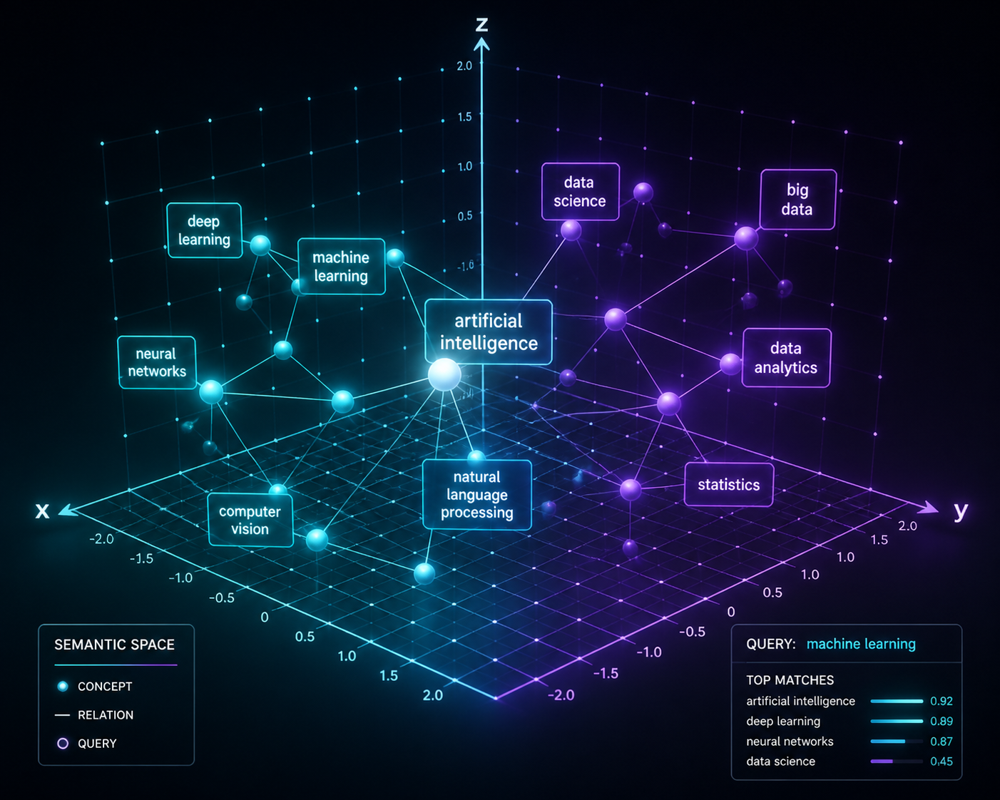

전통적인 검색(Ctrl+F)은 글자가 토씨 하나라도 틀리면 찾지 못합니다. 예를 들어 사용자가 *"월급 언제 들어와?"*라고 검색했을 때 사규 문서에 *"급여 지급일은 매월 25일이다"*라고 적혀 있다면, 기존 키워드 검색은 둘을 전혀 연결하지 못합니다.

하지만 현대의 AI는 이 두 문장이 같은 뜻임을 단번에 알아챕니다. 그 비결이 바로 **임베딩(Embedding)**과 **벡터 데이터베이스(Vector DB)**입니다.

---

## 🗺️ 임베딩: 단어들을 우주 지도 위의 '별자리 좌표'로 만들기


_의미가 비슷한 문장들이 가까운 거리에 뭉치는 다차원 벡터 공간의 원리_

임베딩이란 텍스트(단어, 문장, 문서)를 숫자의 나열인 **'고차원 좌표(Vector)'**로 변환하는 기술입니다.

- [사과] = `[0.82, -0.15, 0.91, ...]`
- [바나나] = `[0.79, -0.12, 0.88, ...]` (사과와 좌표가 아주 가까움!)
- [비행기] = `[-0.45, 0.92, -0.11, ...]` (과일들과 좌표가 아주 멂!)

컴퓨터는 사람의 언어를 이해하지 못하지만, **숫자 간의 각도와 거리(코사인 유사도, Cosine Similarity)**는 0.001초 만에 계산할 수 있습니다. 

*"월급"*과 *"급여"*는 좌표 공간에서 거의 같은 지점에 찍히기 때문에, 사용자가 어떤 표현을 쓰더라도 원하는 문서를 정확하게 찾아낼 수 있는 것입니다.

---

## 🗄️ 벡터 데이터베이스(Vector DB)는 왜 필요할까?

일반 관계형 DB(MySQL, PostgreSQL)는 숫자나 텍스트의 '정확한 일치'를 찾는 데 특화되어 있습니다.

반면 **Chroma, Pinecone, Qdrant, Milvus** 같은 벡터 DB는 **"1,536차원 우주 공간에서 내 질문과 가장 각도가 좁은(비슷한) 문서 상위 5개를 순식간에 골라오는"** 고속 유사도 검색 알고리즘(HNSW 등)에 최적화된 특수 창고입니다.

---

## 💻 5분 실습: 코사인 유사도로 의미 비교하기

두 문장의 임베딩 벡터가 얼마나 가까운지 각도를 재는 기본 원리를 파이썬 수식으로 확인해 보겠습니다.

```python
import math

def cosine_similarity(v1, v2):
    dot_product = sum(a * b for a, b in zip(v1, v2))
    norm_v1 = math.sqrt(sum(a * a for a in v1))
    norm_v2 = math.sqrt(sum(b * b for b in v2))
    return dot_product / (norm_v1 * norm_v2)

# 가상의 3차원 임베딩 예시
# 축 1: 경제/급여 성향, 축 2: 이동수단 성향, 축 3: 음식 성향
vector_salary = [0.95, 0.05, 0.02]      # "급여 지급 규정"
vector_paycheck = [0.92, 0.08, 0.01]    # "월급 언제 입금돼요?"
vector_airplane = [0.05, 0.98, 0.01]    # "비행기 예약 방법"

sim_1 = cosine_similarity(vector_salary, vector_paycheck)
sim_2 = cosine_similarity(vector_salary, vector_airplane)

print(f"급여 vs 월급 유사도: {sim_1:.4f} (거의 1.0에 가까움!)")
print(f"급여 vs 비행기 유사도: {sim_2:.4f} (완전히 다른 분야)")
```

---

## 🎯 Solution Architect 관점 한 줄 요약
> **"임베딩 모델을 고를 때는 언어적 특성(한국어 성능)과 임베딩 차원 크기(메모리 비용), 그리고 검색 지연시간(Latency)의 3자 균형을 잡아야 한다."**
