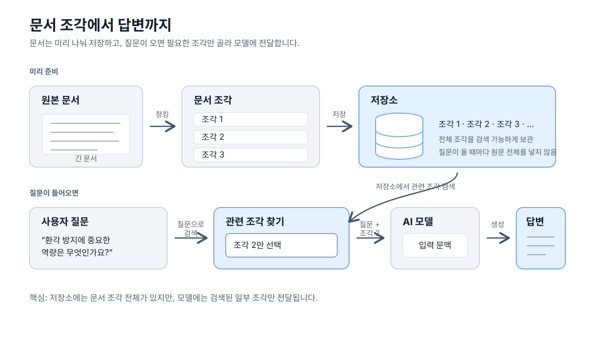

기업에서 AI를 도입할 때 가장 많이 요구하는 프로젝트 1순위는 단연 **RAG(Retrieval-Augmented Generation, 검색 증강 생성)**입니다.

회사 내부에 있는 수백 페이지짜리 매뉴얼이나 계약서 PDF를 AI에게 통째로 던져주면 왜 제대로 읽지 못할까요? 그리고 어떻게 해야 **"몇 페이지, 몇 번째 조항을 참고했다"**고 정확한 출처(Citation)를 찍어주는 똑똑한 시스템을 만들 수 있을까요?

---

## 📚 왜 통째로 넣지 않고 '청킹(Chunking)'해야 할까?


_방대한 사내 문서를 조각(Chunk)내어 인덱싱하고 정확한 출처와 함께 답변을 생성하는 RAG 흐름_

1. **컨텍스트 윈도우 비용**: 100페이지 PDF를 매 질문마다 통째로 모델에 넣으면 토큰 비용이 폭발하고 응답 속도가 10초 이상 느려집니다.
2. **정보 희석 (Lost in the Middle)**: 문서가 너무 길면 LLM은 문서 중간에 숨어 있는 중요한 문장을 읽지 못하고 놓칩니다.
3. **해결책**: 문서를 500자~1,000자 단위의 **'의미 있는 작은 조각(Chunk)'**으로 잘라두고, 질문과 관련된 3~5조각만 쏙쏙 뽑아 LLM에게 건네주는 것이 바로 RAG입니다.

---

## 📌 신뢰성을 만드는 '메타데이터'와 출처(Citation)

기업용 RAG와 장난감 챗봇을 가르는 결정적인 차이는 **'메타데이터(Metadata)'**입니다.

문서를 청킹하여 벡터 DB에 저장할 때 본문 텍스트만 넣는 것이 아니라, 아래와 같은 이름표(메타데이터)를 함께 붙여줍니다.

```json
{
  "chunk_id": "hr_policy_024",
  "source_file": "2026_취업규칙_개정안.pdf",
  "page_number": 14,
  "section": "제3장 연차 및 유급휴가 규정",
  "text": "직원은 매년 15일의 유급 연차를 지급받으며..."
}
```

AI가 답변을 생성할 때 이 메타데이터를 프롬프트에 함께 주입하여, 사용자에게 *"2026_취업규칙_개정안.pdf 14페이지에 따르면"*이라는 신뢰성 높은 출처 링크를 제공할 수 있게 됩니다.

---

## 💻 5분 실습: 슬라이딩 윈도우 청킹 알고리즘

문맥이 문장 중간에서 뚝 끊어지지 않도록 앞뒤 내용을 살짝 겹치게(Overlap) 자르는 표준 청킹 코드입니다.

```python
def chunk_text(text: str, chunk_size: int = 200, overlap: int = 50):
    chunks = []
    start = 0
    while start < len(text):
        end = start + chunk_size
        chunk = text[start:end]
        chunks.append(chunk)
        start += chunk_size - overlap  # 50글자씩 겹치면서 이동
    return chunks

sample_doc = (
    "인공지능 솔루션 아키텍트는 고객사의 비즈니스 문제를 정의하고, "
    "클라우드 인프라와 파운데이션 모델을 최적의 비용으로 연결하는 시스템을 설계합니다. "
    "단순한 모델 파인튜닝보다 데이터 거버넌스, 지연시간 단축, 환각 방지 파이프라인이 더 중요한 역량입니다."
)

result_chunks = chunk_text(sample_doc, chunk_size=80, overlap=20)

for i, chk in enumerate(result_chunks, 1):
    print(f"[조각 {i}] (길이 {len(chk)}자): {chk}")
```

---

## 🔎 저장된 조각 중 필요한 것만 모델에 넣기

문서를 나눠 저장해 두는 이유는 질문마다 원문 전체를 모델에 보내지 않기 위해서입니다. 저장소에는 조각 전체가 남아 있지만, 질문이 들어오면 관련 있는 조각만 찾아 질문과 함께 모델에 전달합니다.


_문서는 미리 청킹해 저장하고, 질문과 관련된 조각만 검색해 모델에 전달하는 과정_

---

## 🎯 Solution Architect 관점 한 줄 요약
> **"RAG 시스템의 품질을 결정하는 것은 80%가 검색(Retrieval)과 청킹 전략이고, 생성 모델(Generation)의 비중은 20%에 불과하다."**
