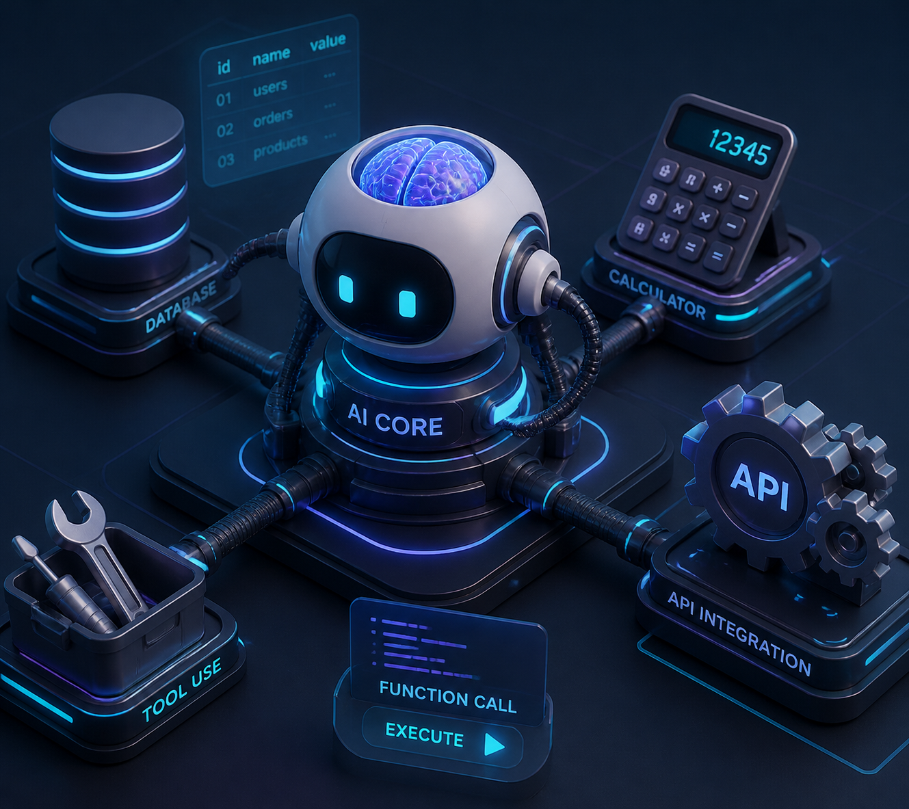

질문만 하면 말로만 답하던 AI가 어떻게 스스로 계산기를 두드리고, 날씨 API를 조회하고, 회사 데이터베이스에서 고객 정보를 꺼내올 수 있을까요?

그 핵심 기술이 바로 OpenAI의 **Function Calling**과 Anthropic의 **Tool Use**입니다.

많은 분들이 오해하지만, **LLM 자체가 직접 파이썬 코드를 실행하거나 인터넷에 접속하는 것이 아닙니다.** 도구 호출의 실제 작동 원리를 파헤쳐 보겠습니다.

---

## 🤖 핵심 원리: AI는 함수를 '실행'하지 않고 '주문서(JSON)'를 씁니다


_LLM은 정형화된 JSON 주문서를 발행하고, 실제 실행은 하네스(시스템)가 처리한 뒤 결과를 다시 전달하는 루프_

1. **메뉴판 제공 (도구 선언)**: 우리가 AI에게 *"너는 `get_weather(city)`라는 함수를 쓸 수 있어"*라고 스키마(메뉴판)를 전달합니다.
2. **판단과 주문서 작성**: 사용자가 *"인천 지금 비 와?"*라고 물으면, AI는 자신이 날씨를 직접 모른다는 것을 알고 문장 대신 아래와 같은 정형화된 **JSON 호출 주문서**를 출력합니다:
   ```json
   {
     "name": "get_weather",
     "arguments": {"city": "Incheon"}
   }
   ```
3. **외부 시스템(하네스)이 실제 실행**: 파이썬 프로그램(백엔드 서버)이 이 JSON을 받아서 진짜 기상청 API를 호출해 `{"weather": "맑음", "temp": 14}`라는 결과를 얻어옵니다.
4. **결과를 AI에게 주입**: 백엔드가 이 결과를 다시 AI에게 건네주면, AI가 비로소 *"인천은 지금 맑고 기온은 14도예요!"*라고 최종 자연어로 대답합니다.

---

## 💻 5분 실습: Function Calling 도구 스키마 구조

API가 이해할 수 있는 표준 도구 정의 JSON 스키마입니다.

```python
# OpenAI / Claude가 이해하는 도구 명세서
tool_definition = {
    "type": "function",
    "function": {
        "name": "search_customer_order",
        "description": "고객의 주문 내역 및 배송 상태를 데이터베이스에서 조회합니다.",
        "parameters": {
            "type": "object",
            "properties": {
                "customer_id": {
                    "type": "string",
                    "description": "고객 고유 ID (예: CUST_1004)"
                },
                "order_status": {
                    "type": "string",
                    "enum": ["all", "shipping", "delivered"],
                    "description": "조회할 주문 상태 필터"
                }
            },
            "required": ["customer_id"]
        }
    }
}

print("도구 스키마 준비 완료: AI가 언제든 이 함수를 호출할 수 있습니다.")
```

이처럼 엄격한 JSON Schema를 정의해 두면, LLM은 엉뚱한 문자열 대신 정확히 시스템이 처리할 수 있는 파라미터를 넘겨주게 됩니다.

---

## 🎯 Solution Architect 관점 한 줄 요약
> **"Function Calling은 자연어라는 비정형(Unstructured) 세계와 API/DB라는 정형(Structured) 세계를 잇는 가장 강력한 표준 다리다."**
