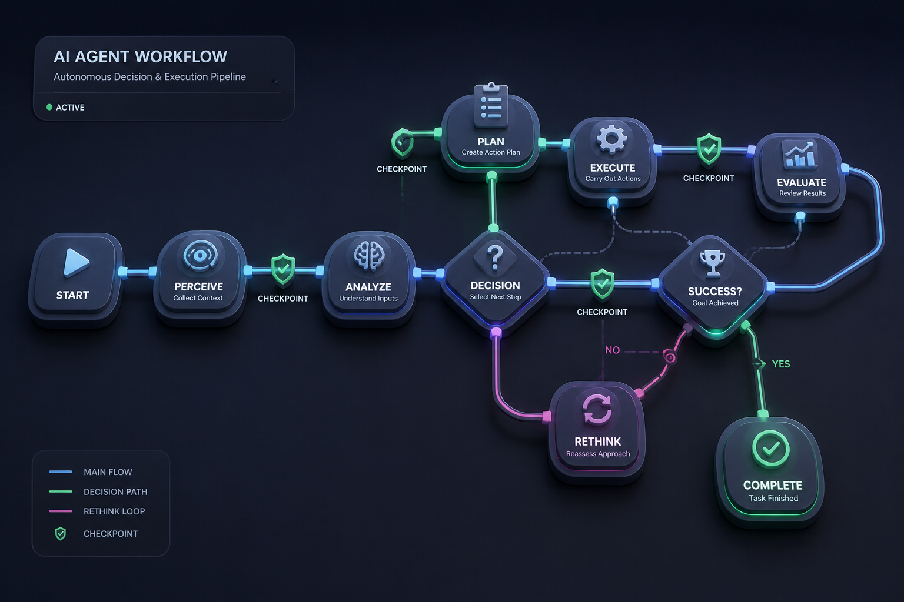

AI 챗봇이 한 번 묻고 한 번 답하는 일대일 대화라면, **AI 에이전트(Agent)**는 목표를 줄 때까지 스스로 계획을 세우고(Plan), 도구를 쓰고(Act), 결과를 관찰하며(Observe) 끝까지 임무를 완수하는 시스템입니다.

하지만 단순히 LLM에게 자유를 주고 무한 루프를 돌리면, 엉뚱한 곳에서 뱅뱅 돌거나 엉뚱한 파일 수백 개를 지워버리는 대형 사고가 날 수 있습니다.

현업 엔터프라이즈에서 가장 주목받는 **상태 머신(State Machine) 기반 에이전트 설계 기법(LangGraph)**을 알아보겠습니다.

---

## 🚦 자율 에이전트에게 '체크리스트와 결재선'을 쥐어주는 법


_명확한 단계(Node)와 전이 조건(Edge)으로 에이전트의 경로 이탈을 막는 그래프 아키텍처_

1. **상태(State) 중심 관리**: 에이전트가 지금까지 무슨 도구를 썼고, 어떤 데이터를 모았는지 단 하나의 공유 상태 객체(State Dict)에 투명하게 기록합니다.
2. **조건부 분기(Conditional Edge)**:
   - *"검색 결과가 충분한가?"* → YES면 답변 작성 단계로 이동, NO면 검색 쿼리를 바꿔서 재시도(최대 3회 제한).
3. **인간 개입 (Human-in-the-loop)**:
   - 계좌 이체, 결제, 데이터베이스 삭제, 외부 이메일 발송 같은 **민감한 행동 직전에는 반드시 실행을 일시정지하고 인간 관리자의 최종 승인 버튼을 기다리도록 설계**합니다.

---

## 💻 5분 실습: 간단한 상태 머신 그래프 흐름도

LangGraph가 에이전트를 제어하는 기본 루프 개념을 파이썬 상태 딕셔너리로 시뮬레이션해 보겠습니다.

```python
# 에이전트의 공유 상태(State) 정의
agent_state = {
    "goal": "인천시 청년 지원금 조회 후 요약 보고서 작성",
    "step": "SEARCH_BENEFITS",
    "retrieved_docs": [],
    "retry_count": 0,
    "final_report": None
}

def router(state):
    if state["step"] == "SEARCH_BENEFITS":
        if len(state["retrieved_docs"]) > 0:
            return "DRAFT_REPORT"
        elif state["retry_count"] < 3:
            return "RETRY_SEARCH"
        else:
            return "ESCALATE_TO_HUMAN"
    elif state["step"] == "DRAFT_REPORT":
        return "HUMAN_APPROVAL"
    return "END"

# 상태 전이 테스트
agent_state["retrieved_docs"] = ["인천 청년 월세 지원 20만 원", "자격증 응시료 실비 지원"]
next_step = router(agent_state)
print(f"현재 상태: {agent_state['step']} -> 다음 실행 노드: {next_step}")
```

---

## 🤖 에이전트 구축의 4대 핵심 개념 총정리

현대 에이전트 시스템을 지탱하는 4가지 필수 기둥입니다.

### 1. 루프 엔지니어링 (Loop Engineering / Agent Loop)
- **일상 비유**: 목표를 달성할 때까지 "생각하기 → 행동하기 → 결과 확인하기"를 반복하며 에러가 나면 다른 도구를 꺼내 드는 **오뚝이 요리사**.
- **핵심 원리**: 단발성 질의응답이 아니라, `Thought → Action → Observation` 사이클을 돌며 목표가 완료되거나 중단 조건에 도달할 때까지 상태를 갱신하는 자율 실행 루프 설계입니다.

### 2. 에이전틱 워크플로 (Agentic Workflow)
- **일상 비유**: 사원 한 명이 주먹구구로 다 하는 게 아니라, '기획 에이전트 → 코딩 에이전트 → 검수 에이전트'가 각자의 역할을 넘겨받으며 완성품을 만드는 **분업화된 공정 라인**.
- **핵심 원리**: 하나의 거대 프롬프트로 모든 걸 해결하려 하지 않고, 여러 단계의 특화 에이전트가 체계적으로 연결되어 높은 품질을 반복 생산하는 협업 파이프라인입니다.

### 3. LangChain vs LangGraph
- **LangChain**: LLM 초기에 프롬프트와 도구를 체인(사슬)처럼 일직선으로 엮어주던 클래식 공구 세트.
- **LangGraph**: 순환 루프와 상태(State) 전이가 필요한 복합 에이전트를 방향성 그래프(Graph) 기반의 상태 머신으로 정밀 제어하는 최신 표준 프레임워크.

### 4. 에이전트 메모리 (Agent Memory)
- **일상 비유**: '지금 작업대 위의 메모지(단기 작업 기억)'와 '서재 캐비닛의 장기 보관 서류철(장기 영구 기억)'.
- **핵심 원리**: 대화 세션 맥락을 유지하는 단기 기억(Session Checkpointer)과, 과거 사용자 선호도·사규를 벡터 DB에 영구 저장하고 재사용하는 장기 기억(Long-term Memory)의 이중화 구조입니다.

---

## 🎓 1주일 스터디 완주를 축하합니다! (AI SA 로드맵 요약)

지난 1주일 동안 우리는 AI Solution Architect가 갖추어야 할 핵심 7가지 뼈대를 모두 짚었습니다:

1. **Day 01**: 토큰화와 트랜스포머의 다음 단어 확률 예측 원리
2. **Day 02**: System / User / Assistant 역할 분리와 가드레일 설계
3. **Day 03**: Temperature와 Top-P 파라미터 튜닝
4. **Day 04**: 고차원 임베딩과 벡터 DB의 시맨틱 검색 메커니즘
5. **Day 05**: 엔터프라이즈 RAG의 청킹 전략과 메타데이터 출처(Citation) 매핑
6. **Day 06**: Function Calling과 Tool Use 도구 연동 루프
7. **Day 07**: 상태 머신과 인간 개입(Human-in-the-loop) 에이전트 아키텍처

이 7가지 개념이 바로 우리가 기억해 둔 **'SA 포트폴리오 핵심 3대 프로젝트(Enterprise RAG, 자율 업무 에이전트, API 라우터)'**를 실제로 구현하는 가장 탄탄한 기반이 됩니다!
