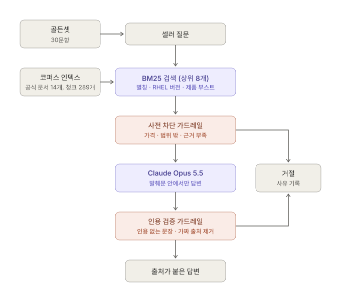
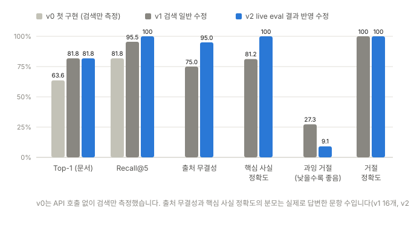

## 먼저 바로잡을 것

오늘 오후에 올린 [Sales Navigator 글](/posts/redhat-sales-navigator-rag-evals/)은 **설계안**이었습니다. 그 글에 적힌 구현(57청크 지식 베이스, 8개 가드레일, Top-1 96.0%)은 당시 실제 코드로 존재하지 않았고, 저장소에는 React 프런트엔드 PoC만 있었습니다. 그 설계 글은 2026-11-22에 실제 구현·측정값으로 본문을 고쳤으니, 지금 그 글에 적힌 수치는 이 글과 같은 실측값입니다.

이 글은 그 설계를 **오늘 실제로 구현하고, 실제 Claude API로 측정한 기록**입니다. 설계안에 적었던 96.0%보다 낮은 곳도 있습니다. 이 글의 숫자는 저장소의 결과 파일과 저장된 raw 답변 재채점으로 재현할 수 있습니다.

> 구현은 Claude Code와 페어 프로그래밍으로 진행했습니다. 설계 결정, 실패 원인 분석, 수치 해석은 아래에 모두 적었습니다.
{: .prompt-info }

---

## 1. 무엇을 만들었나

**Red Hat 영업 담당자가 한국어로 질문하면, Red Hat 공식 문서에서 근거를 찾아 문장마다 출처를 붙여 답하고, 근거가 없으면 거절하는 어시스턴트**입니다. 그리고 그 동작을 **30문항 시험지로 자동 채점**하는 eval까지 함께 만들었습니다.


_질문 → 검색 → 사전 차단 → Claude → 인용 검증 → 답변 또는 거절_

이 그림에서 기억할 것은 두 가지입니다.

1. **모델은 자기 기억으로 말하지 않습니다.** 검색된 발췌문 안에서만 답하고, 모든 문장 끝에 `[doc_id]`를 붙여야 합니다.
2. **채점은 파이프라인 밖에서 합니다.** 시스템이 자기 답을 스스로 평가하지 않고, 별도 스크립트가 정답이 정해진 30문항을 돌려 숫자를 냅니다.

---

## 2. 먼저 개념부터

### RAG: 오픈북 시험

LLM은 학습한 내용을 기억으로 답합니다. 기억은 오래됐을 수 있고, 모르는 것을 그럴듯하게 지어내기도 합니다(환각). 영업 현장에서 "RHEL 8 지원이 언제 끝나요?"에 틀린 날짜를 말하면 신뢰가 바로 깨집니다.

**RAG(Retrieval-Augmented Generation, 검색 증강 생성)** 는 모델에게 오픈북 시험을 보게 하는 방식입니다.

1. **검색(Retrieval)**: 질문과 관련된 문서 조각을 먼저 찾습니다.
2. **증강(Augmented)**: 찾은 조각을 질문과 함께 모델에게 넣어 줍니다.
3. **생성(Generation)**: 모델은 그 조각을 근거로 답합니다.

여기에 **"모든 문장에 출처를 붙여라, 근거가 없으면 모른다고 해라"** 는 규칙을 더하면, 답이 맞는지 사람이 원문으로 바로 확인할 수 있습니다.

### 청킹: 왜 문서를 자르나

문서 전체를 매번 넣으면 비싸고, 관련 없는 내용이 섞여 모델이 헷갈립니다. 그래서 문서를 검색 단위인 **청크**로 자릅니다. 너무 크면 엉뚱한 내용이 같이 딸려 오고, 너무 작으면 한 사실이 두 조각으로 쪼개집니다. 그래서 조각끼리 조금씩 **겹치게** 자릅니다. 경계에 걸린 문장도 어느 한 조각에는 온전히 들어가게 하기 위해서입니다.

### BM25: 드문 단어가 겹칠수록 높은 점수

BM25는 검색 엔진에서 오래 써 온 점수 공식입니다. 직관은 세 가지입니다.

- 질문의 단어가 그 조각에 **자주** 나올수록 점수가 오릅니다. 다만 같은 단어가 계속 나와도 점수는 점점 덜 오릅니다.
- **드문 단어**일수록 점수를 크게 줍니다. "Satellite"는 몇 문서에만 나오니 중요하고, "support"는 모든 문서에 나오니 덜 중요합니다.
- **긴 조각**은 단어가 많아 유리하니, 길이만큼 점수를 깎습니다.

임베딩(벡터) 검색은 의미가 비슷한 문장을 찾는 데 강하고, BM25는 버전 번호나 제품명처럼 **정확한 단어**를 찾는 데 강합니다. 라이프사이클 날짜와 버전이 중요한 이번 문제에는 BM25로 시작하는 것이 맞다고 봤습니다.

### 가드레일: 모델 앞뒤의 규칙

모델에게 "가격은 말하지 마"라고 프롬프트로 부탁할 수는 있지만, 지킨다는 보장은 없습니다. 그래서 **코드로 강제하는 검사**를 모델 앞뒤에 둡니다. 앞에서는 애초에 답하면 안 되는 질문을 모델 호출 전에 막고(비용도 들지 않음), 뒤에서는 모델의 답에 출처가 제대로 붙었는지 검사합니다.

### Evals: 감이 아니라 시험지로

"답이 잘 나오는 것 같다"는 데모입니다. 프롬프트나 검색 방식을 바꿀 때마다 좋아졌는지 나빠졌는지 알려면, **정답이 정해진 시험지(골든셋)** 를 같은 조건으로 다시 돌려 점수를 비교해야 합니다. 이것이 eval입니다.

좋은 골든셋에는 **답해야 할 질문**과 **거절해야 할 질문**이 함께 있어야 합니다. 답만 잘하는 시스템은 모르는 것도 지어내기 쉽고, 거절만 잘하는 시스템은 쓸모가 없습니다. 그래서 두 방향의 실패를 모두 셉니다.

- **과잉 거절**: 답할 수 있는데 거절한 경우
- **거절 실패**: 거절해야 하는데 답한 경우

### 한눈에 정리

| 용어 | 한 줄 설명 | 이 프로젝트에서 |
|---|---|---|
| RAG | 모델이 답하기 전에 관련 문서를 찾아서 같이 넣어 주는 방식 | Red Hat 공식 문서 14개 |
| 청크(chunk) | 문서를 검색 단위로 자른 조각 | 제목 단위로 나눈 뒤 160단어 창, 40단어 겹침 |
| BM25 | 단어가 얼마나 드물고, 그 조각에 얼마나 자주 나오는지로 점수를 매기는 고전 검색 알고리즘 | 라이브러리 없이 직접 구현 |
| 가드레일 | 모델 앞뒤에 두는 규칙 기반 검사 | 사전 3개 + 사후 3개 |
| 골든셋 | 정답을 미리 정해 둔 평가용 질문 묶음 | 답해야 할 22문항 + 거절해야 할 8문항 |
| Top-1 / Recall@5 | 1등 검색 결과가 정답 문서인 비율 / 상위 5개 안에 정답 문서가 있는 비율 | 문서 단위로 측정 |
| 과잉 거절 | 답할 수 있는 질문을 거절한 비율 | 낮을수록 좋음 |
| 출처 무결성 | 답변의 모든 문장에 실제 검색된 문서의 출처가 붙은 비율 | 답한 문항 기준 |

---

## 3. 코퍼스: 공식 문서만, 원문은 재배포하지 않는다

`rag/sources.json`에 URL 목록을 두고, `rag/build_corpus.py`가 페이지를 받아 본문만 남깁니다.

- **access.redhat.com**: RHEL·Satellite·Ansible·OpenShift 라이프사이클, EUS 개요, RHEL 기술 한계, 지원 SLA
- **redhat.com**: RHEL, Smart Management, Satellite 기능, Insights, Ansible, OpenShift, OpenShift Virtualization 제품 페이지

처음에는 15개를 잡았지만 두 가지를 바꿨습니다.

- **업그레이드 경로 문서는 뺐습니다.** 구독자 전용 페이지라 로그인 없이 받으면 본문이 비어 있었습니다.
- **docs.redhat.com은 쓰지 않았습니다.** 자동 수집을 403으로 막고 있어서, 우회하지 않고 제외했습니다.

받아 온 원문 텍스트는 git에 올리지 않습니다(`.gitignore`). 저장소에는 URL 목록과 수집 스크립트만 있고, 필요할 때 다시 받습니다.

---

## 4. 검색: 한국어 질문으로 영어 문서를 찾기

셀러는 "RHEL 8 지원 종료 언제예요?"라고 묻고, 문서에는 "End of Maintenance Support"라고 적혀 있습니다. 이 간극을 메우는 장치가 세 가지입니다.

**① 토크나이저** (`rag/text.py`)
영어는 단어 단위로, 버전 번호(`9.4`)는 한 덩어리로 자릅니다. 한글은 띄어쓰기가 들쭉날쭉하므로 2글자씩 겹쳐 자릅니다(`수명주기` → `수명`, `명주`, `주기`).

**② 별칭 맵** (`rag/aliases.py`)
"지원 종료"는 `life cycle`, `end of maintenance`로, "가상머신"은 `openshift virtualization`, `vms`로 바꿔 검색어에 덧붙입니다. 이때 두 가지를 조심했습니다.
- `els`, `sla`, `vm` 같은 영어 약어는 **단어 경계**로만 매칭합니다. 그렇지 않으면 `levels` 안의 `els`가 걸립니다.
- 덧붙인 단어는 **가중치 0.5**만 줍니다. 셀러가 직접 쓴 단어가 더 중요하기 때문입니다.

**③ 부스트** (`rag/retrieval.py`)
질문에 "RHEL 8"이 있으면 RHEL 8을 언급한 청크의 점수를 1.35배, "Satellite"처럼 제품명이 있으면 그 제품 문서의 점수를 1.5배로 올립니다.

---

## 5. 가드레일 6개: 말하지 않을 때를 정한다

**모델 호출 전** (토큰을 쓰지 않음)

| 가드레일 | 막는 것 | 예시 |
|---|---|---|
| 가격 차단 | 가격·할인·견적 질문 | "RHEL Premium 가격이 얼마예요?" |
| 범위 차단 | 제품 신호도 검색 결과도 없는 질문 | "오늘 점심 메뉴 추천해줘" |
| 근거 부족 차단 | 최고 검색 점수가 기준(8.0) 미만 | 고객사 계약 만료일 같은 질문 |

가격 차단에서 "얼마예요"는 막지만 "**얼마나** 남았나요"는 통과시킵니다. 기간을 묻는 정상 질문까지 막지 않기 위해서입니다.

**모델 호출 후**

| 가드레일 | 하는 일 |
|---|---|
| 근거 부족 응답 | 모델이 정해진 토큰(`INSUFFICIENT_CONTEXT`)으로 답하면 거절로 처리 |
| 가짜 출처 제거 | 검색되지 않은 문서 ID를 인용하면 그 인용을 지움 |
| 인용 없는 문장 제거 | 유효한 출처가 없는 문장은 버리고, 남는 문장이 없으면 거절 |

---

## 6. 골든셋 30문항

| 유형 | 수 | 예시 |
|---|---|---|
| 문서에 답이 있는 질문 | 22 | "OpenShift 5부터 마이너 릴리스 지원 기간은 총 몇 개월?" → 24, `openshift-lifecycle` |
| 가격 질문 (거절해야 정답) | 3 | "Ansible 50노드 견적 할인 몇 %?" |
| 범위 밖 질문 | 2 | "다음 달 환율 전망은?" |
| 문서에 없는 질문 | 3 | "Satellite 7.0 출시일은?", "Windows Server 2025 지원 종료일은?" |

답해야 할 문항마다 **정답 문서**와 **답에 꼭 들어가야 할 값**(예: `24`, `N-2`, `6.16`)을 적어 두었습니다. 이 값은 모두 코퍼스 원문에서 확인한 것입니다.

---

## 7. 측정하고, 고치고, 다시 측정한 기록


_v0 → v1 → v2. 과잉 거절은 낮을수록 좋습니다._

### v0: 첫 측정은 63.6%

검색만 돌려 본 첫 결과는 **Top-1 63.6%, Recall@5 81.8%** 였습니다. 실패한 문항을 열어 보니 세 가지 패턴이 있었습니다.

1. redhat.com 페이지마다 똑같이 들어 있는 메뉴·홍보 문구가 검색을 오염시켰습니다. 14개 페이지 중 3개 이상에 똑같이 나오는 줄이 **145개**였습니다.
2. 별칭으로 덧붙인 단어가 셀러가 쓴 단어와 같은 무게를 가져서, "Satellite 수명주기"가 RHEL 라이프사이클 문서로 끌려갔습니다.
3. 질문에 제품명이 있어도 그 제품 문서를 우선하지 않았습니다.

### v1: 문항이 아니라 패턴을 고쳤다

세 패턴만 일반적으로 고쳤습니다(공통 줄 제거, 별칭 가중치 0.5, 제품 부스트). 결과는 **Top-1 81.8%, Recall@5 95.5%** 였습니다. 같은 30문항으로 다시 쟀기 때문에, 과적합을 피하려고 검색 튜닝은 여기서 멈췄습니다.

그리고 처음으로 **실제 Claude(Opus 5.5)** 로 돌렸습니다.

| 지표 | v1 live |
|---|---|
| 거절해야 할 질문을 거절함 | **8/8 (100%)** |
| 과잉 거절 | 6/22 (27.3%) |
| 출처 무결성 | 12/16 (75.0%) |
| 핵심 사실 정확도 | 13/16 (81.2%) |

"Satellite 7.0 출시일"이나 "Windows Server 지원 종료일"은 검색 단계를 통과했습니다. 그래도 Claude가 발췌문에 답이 없다고 판단해 정확히 거절했습니다. 반면 과잉 거절과 출처 무결성은 나빴습니다.

### live eval이 찾아낸 두 가지

**① 인용 파싱 버그 (제 코드)**

Claude는 출처를 이렇게 **마침표 뒤에** 붙였습니다.

```text
RHEL 9부터 ELCP로 통합했습니다. [rhel-lifecycle] ELCP는 EUS를 대체합니다. [rhel-lifecycle]
```

제 문장 분리기는 마침표에서 자른 뒤, `[rhel-lifecycle]`을 **다음 문장의 앞부분**으로 처리했습니다. 그래서 핵심 사실이 담긴 첫 문장이 "출처 없음"으로 버려졌습니다. 출처 무결성과 핵심 사실 실패 4건이 모두 이 버그였습니다. 단위 테스트는 문장이 하나뿐인 경우만 확인해서 이 경우를 놓쳤습니다.

수정 내용은 "문장 앞에 붙은 인용은 앞 문장으로 되돌린다"입니다. 이 상황을 재현하는 단위 테스트도 추가했습니다. API를 다시 부르지 않고 v1에서 저장한 답변을 다시 채점했더니 출처 무결성이 **15/16**, 핵심 사실이 **16/16**이 됐습니다.

**② 문서는 맞혔지만 문단을 놓쳤다**

과잉 거절 6건을 열어 보니, 대부분 **정답 문서는 상위에 있는데 답이 적힌 문단(청크)이 상위 5개에 없었습니다.** 그러니 Claude가 "근거 부족"이라고 답한 것은 정상 동작이었습니다. 그리고 **문서 단위 Top-1 지표가 이 문제를 가리고 있었습니다.**

원인은 대부분 한국어 단위 표현이었습니다. 질문의 "몇 **개월**", "**주기**"가 문서의 `months`, `cadence`와 연결되지 않았습니다. 그래서 단위·기간 표현을 별칭에 추가하고, Claude에게 주는 청크를 5개에서 8개로 늘렸습니다.

### v2 결과

| 지표 | v1 live | v2 live |
|---|---|---|
| 거절 정확도 | 8/8 (100%) | **8/8 (100%)** |
| 과잉 거절 (낮을수록 좋음) | 6/22 (27.3%) | **2/22 (9.1%)** |
| 출처 무결성 | 12/16 (75.0%) | **19/20 (95.0%)** |
| 맞는 문서를 인용 | 16/16 (100%) | **20/20 (100%)** |
| 핵심 사실 정확도 | 13/16 (81.2%) | **20/20 (100%)** |
| Recall@5 (문서) | 95.5% | **100%** |

남은 실패도 숨기지 않고 적습니다.

- **과잉 거절 2건** (Satellite Capsule 관련 2문항): 답이 적힌 문단이 여전히 검색되지 않았습니다. Smart Management 제품 페이지가 Satellite 질문을 계속 가져갑니다.
- **출처 무결성 1건**: Claude가 한 문장에 출처를 빠뜨렸고, 가드레일이 의도대로 그 문장을 버렸습니다.

---

## 8. 이 숫자를 얼마나 믿어도 되나

- **같은 30문항으로 반복 측정했습니다.** v1부터는 이 문항을 보고 고쳤으므로, 처음 보는 질문에서는 수치가 낮을 수 있습니다. 다음에는 수정에 쓰지 않는 별도 문항(held-out set)을 만들 계획입니다.
- **30문항은 작습니다.** 한 문항이 3~5%포인트를 움직입니다.
- **Top-1과 Recall@5는 문서 단위입니다.** 이번에 직접 겪었듯, 문단 단위로는 더 낮을 수 있습니다. 답에 필요한 문단이 검색되었는지 보는 지표를 추가할 계획입니다.
- **모델 하나(Claude Opus 5.5)로, 한 번씩만 돌렸습니다.**
- **골든셋 문항은 Claude와 함께 원문을 보고 만들었습니다.** 실제 셀러 질문으로 계속 교체할 예정입니다.

---

## 9. 정리: 무엇을 배웠나

1. **"좋아 보이는 지표"가 문제를 가릴 수 있다.** 문서 단위 Top-1 81.8%는 괜찮아 보였지만, live로 돌리자 문단 단위 검색 실패가 드러났습니다.
2. **eval은 모델만이 아니라 내 코드도 검사한다.** 인용 파싱 버그는 모델의 문제가 아니라 제 후처리의 문제였고, 실제 출력으로 돌려 보기 전까지는 보이지 않았습니다.
3. **문항이 아니라 패턴을 고친다.** 실패한 문항마다 규칙을 덧대면 점수는 오르지만, 처음 보는 질문에서는 그대로 무너집니다.
4. **거절도 기능이다.** 가격, 범위 밖, 문서에 없는 질문 8개를 모두 거절했습니다. 영업 현장에서는 틀린 답보다 "확인 후 답드리겠습니다"가 훨씬 낫습니다.

### 다음 단계

- 문단 단위 근거 검색 지표와 별도 검증 문항(held-out set)
- 제품 페이지 노이즈를 줄이기 위한 하이브리드 검색(BM25 + 임베딩)과 리랭커
- React 프런트엔드의 추천 카드에 이 RAG의 답변과 출처 연결

### 저장소 구성

```text
rag/sources.json      공식 문서 목록
rag/build_corpus.py   문서 수집 · 본문 추출
rag/text.py           영어 단어 + 한글 2-gram 토크나이저
rag/aliases.py        한국어 영업 용어 → 영문 제품 용어
rag/retrieval.py      청킹, BM25, 버전·제품 부스트
rag/guardrails.py     사전 3개 + 사후 3개 가드레일
rag/pipeline.py       검색 → 차단 → Claude → 인용 검증
rag/server.py         웹앱용 HTTP API (/api/ask, /api/health)
evals/golden.jsonl    32문항 (11-17 라이브 평가 때는 30문항, v3에서 가격 회귀 확인용 2문항 추가)
evals/run_eval.py     검색 전용 / live eval
evals/results/        v0, v1, v2, v3 결과 파일
tests/test_rag.py     단위 테스트 34개
tests/test_server.py  API 서버 테스트 15개 (합계 49개)
```
