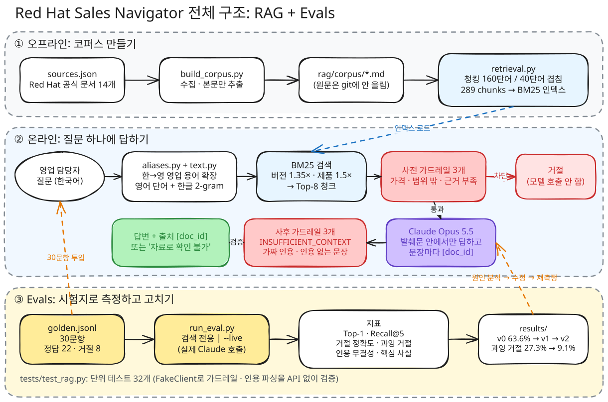

> **2026-11-22 정정.** 이 글은 2026-11-17 14:30에 **설계안**으로 올렸습니다. 그때 본문에 적힌 수치(57청크, 8종 가드레일, Top-1 96.0%, 단위 테스트 64개, `POST /api/advise`)는 설계 가안이었고, 실제 코드로 측정한 값이 아니었습니다. 같은 날 18:07에 구현과 라이브 Claude(`claude-opus-5-5`) 측정이 끝났고, 지금 본문은 **실제 구현과 결과 파일(`evals/results/`)에 있는 값으로 고친 상태**입니다. 구현과 개선 과정 전체는 [구현기](/posts/redhat-sales-navigator-rag-evals-build-log/)에 있습니다.
{: .prompt-warning }

## 이 프로젝트를 한 문장으로

고객이 "RHEL 8 ELS는 언제까지 쓰고, 그다음엔 어떻게 되죠?"라고 물을 때, **Red Hat 공식 문서에서 근거 문단을 찾아 원문 URL과 함께 답하고, 근거가 없으면 답하지 않는 영업용 AI 어시스턴트**를 만들었습니다. 그리고 그 답이 실제로 맞는지를 **정답을 적어 둔 시험지로 자동 채점**하는 구조까지 붙였습니다.

핵심은 "AI가 똑똑한가"가 아니라 **"근거 없이는 말하지 않게 만들었는가, 그걸 숫자로 증명했는가"** 입니다. SA 면접에서 RAG를 이야기할 때 거의 반드시 나오는 두 질문이 이 두 가지입니다.

---

## 0. 왜 만들었나 — 체크리스트 엔진의 두 가지 빈칸

원래 이 데모는 체크리스트 8문항짜리 규칙 엔진이었습니다. 고객 환경(서버 규모, 가장 오래된 RHEL 버전, 보유 제품, 패치·보안 부담, 가상화 대안 검토, 구독 갱신 시점…)을 체크하면 **7개 세일즈 플레이**(Upsell / Cross-sell 후보)와 한국어 대화 스크립트를 보여 주는 방식입니다. 화면은 잘 돌아갔지만, 실무에 들고 나가면 두 곳에서 막혔습니다.

**빈칸 1 — "왜 이 제품입니까?"에 답할 근거가 없다.**
규칙 엔진은 `if 폐쇄망 then Satellite` 같은 조건문입니다. 논리는 맞지만, 고객 앞에서는 이렇게 되묻습니다.

> "그건 그쪽 생각이고, 레드햇 공식 문서 어디에 그렇게 나와 있죠?"

이때 브라우저 탭을 열어 문서를 찾기 시작하면 대화가 끊깁니다. 추천과 동시에 **공식 문서 원문 링크와 인용 문장**이 화면에 붙어 있어야 합니다.

**빈칸 2 — 좋아졌는지 나빠졌는지 알 방법이 없다.**
프롬프트를 고치고 검색 방식을 바꿀 때마다 "이게 더 나아진 건가?"를 판단할 기준이 없었습니다. 대충 몇 개 물어보고 "잘 나오네"로 끝내면, 그건 데모이고 제품이 아닙니다. 그래서 **정답을 미리 적어 둔 시험지(골든셋)와 자동 채점기**를 함께 만들었습니다.

두 번째 빈칸을 채우는 것이 이 프로젝트의 진짜 주제입니다. AI 기능은 누구나 붙일 수 있지만, **"Top-1 몇 %, 거절 정확도 몇 %"를 근거 파일까지 대면서 방어할 수 있는 사람**은 드물기 때문입니다.

---

## 1. 전체 구조 한 장

```text
[체크리스트 8문항]
      │  고객 시나리오 문자열
      ▼
[React 18 SPA]
  ├ 추천 솔루션 카드   규칙 엔진 · 세일즈 플레이 7종 · 한국어 스크립트
  └ RAG 어시스턴트 카드  질문 입력 · 인용 · 거절 사유
      │  POST /api/ask
      ▼
[Python RAG 서비스]   표준 라이브러리만 사용, 외부 검색 서비스 없음
  ① 사전 가드레일   가격 / 범위 밖 / 근거 부족 → 모델 호출 없이 거절
  ② BM25 검색 top-8
     한글 2-gram · 별칭 16묶음 · 제품 1.5배 · RHEL 메이저 버전 1.35배
      │
      ▼
[Claude Messages API]   문장마다 [doc_id] 인용 강제 (claude-opus-5-5)
      │
      ▼
[사후 가드레일]  가짜 인용 제거 · 인용 없는 문장 제거 · 근거 부족 응답 처리
      │
      ▼
[응답]  status + reason + answer + citations + retrieved + top_score

지식 베이스  공식 문서 14개 / 289청크 (v3 코퍼스 재수집 시 292청크)
평가        골든셋 30문항(답 22 + 거절 8) → v3 32문항(답 23 + 거절 9)
```

이 그림에서 기억할 것은 딱 두 가지입니다.

1. **근거는 맨 아래 지식 베이스에만 있다.** 모델은 자기 기억으로 말하지 않고, 검색된 발췌문 안에서만 문장을 만듭니다.
2. **채점기는 파이프라인 밖에 따로 있다.** 서비스가 자기 답을 스스로 칭찬하지 않고, 별도 스크립트가 같은 문항을 돌려 숫자를 뽑습니다.

### 구현 후에 정리한 구조 (Excalidraw)


_① 코퍼스 만들기 → ② 질문 하나에 답하기 → ③ 시험지로 측정하고 고치기 (Excalidraw로 작성, [원본 .excalidraw 파일](/assets/img/posts/sales-navigator-architecture.excalidraw))_

- **① 오프라인:** 공식 문서 14개를 받아 본문만 남기고, 제목(헤딩) 단위로 나눈 뒤 160단어 창으로 잘라 289개 청크의 BM25 인덱스를 만듭니다. 원문은 저장소에 올리지 않고 필요할 때 다시 받습니다.
- **② 온라인:** 한국어 질문을 영어 제품 용어로 넓혀 검색하고, 모델을 부르기 전과 후에 가드레일을 3개씩 둡니다. 가격 질문이나 근거가 부족한 질문은 Claude를 호출하기 전에 거절합니다.
- **③ Evals:** 골든셋을 같은 파이프라인에 그대로 넣고 지표를 냅니다. 결과 파일(v0 → v1 → v2)을 보고 원인을 찾아 고친 뒤 다시 측정합니다. 단위 테스트 **49개**(RAG 34 + API 15)는 API 없이 가드레일과 인용 파싱만 따로 검증합니다.

---

## 2. 지식 베이스: "근거"를 파일로 고정한다

### 왜 벡터 DB가 아니라 원문 텍스트 파일인가

보통 RAG 하면 PDF를 잘라 벡터 DB에 넣는 그림을 떠올립니다. 이번에는 **공식 문서 페이지 하나 = 텍스트 파일 하나**로 만들었습니다(`rag/corpus/{doc_id}.md`, git에는 올리지 않음).

그 이유는 화면에 "근거"를 보여 줘야 하기 때문입니다. 벡터 DB에 넣고 `similarity 0.83`만 받으면 고객에게 보여 줄 것이 없습니다. 반면 파일마다 머리말에 인용에 필요한 값이 같이 들어 있습니다.

| 필드 | 역할 |
| --- | --- |
| `doc_id` | 인용 토큰. 답변 문장 끝에 `[rhel-lifecycle]`처럼 붙고, 청크 ID의 접두어가 됨 |
| `title` | 인용 카드에 표시되는 공식 문서 제목 |
| `url` | 고객이 클릭해서 열 수 있는 원문 주소 |
| `fetched` | 언제 수집했는지 (문서는 개정되므로 날짜가 필요) |
| 본문의 `##`·`###` 헤딩 | 청크의 `section`. 인용이 "어느 절"인지까지 가리킴 |

즉 **인용의 최소 단위가 "문서 + 절"** 입니다. 인용이 `[rhel-lifecycle]`이라고 말하면, 그 카드는 RHEL 라이프사이클 페이지의 특정 절과 URL로 바로 연결됩니다.

### 규모와 청킹

- 공식 문서 **14건 / 289청크** (2026-11-17 라이브 측정 기준). 11-19에 코퍼스를 다시 받았을 때는 **292청크**였습니다.
- 청킹: 문서를 **헤딩 단위 절**로 나누고, 각 절을 **160단어 창**으로 자르되 **40단어씩 겹치게** 잘라냅니다(`CHUNK_WORDS=160`, `OVERLAP_WORDS=40`). 검색용 텍스트는 `문서 제목 + 헤딩 경로 + 본문`을 합쳐 만듭니다.
- 처음 받았을 때는 460청크였습니다. redhat.com 페이지마다 똑같이 붙는 메뉴·홍보 줄이 섞여 있었고, **3개 이상 문서에 똑같이 나오는 줄 145개**를 걷어내자 289청크로 줄었습니다. 같은 문장이 14개 문서에 다 있으면 검색기가 "어디에나 있는 문장"을 근거로 가져옵니다.

겹치게 자르는 이유는 간단합니다. 절을 정확히 160단어로만 자르면 경계에 걸린 문장이 두 조각으로 쪼개져 어느 쪽에도 온전히 없습니다. 40단어를 겹치면 경계 문장도 최소 한 조각에는 통째로 들어갑니다.

| 문서 (`doc_id`) | 내용 |
| --- | --- |
| `rhel-lifecycle` | RHEL 라이프사이클·ELCP·확장 지원 정책 |
| `rhel-eus`, `rhel-limits` | EUS 개요, 기술 한계(메모리·CPU 등) |
| `rhel-overview` | RHEL 제품 페이지 |
| `support-sla` | 프로덕션 지원 SLA(응답 시간·등급) |
| `satellite-lifecycle`, `satellite-features` | Satellite 라이프사이클·기능 |
| `smart-management` | Smart Management 제품 페이지 |
| `insights` | Insights(현 Lightspeed) 제품 페이지 |
| `aap-lifecycle`, `ansible` | Ansible Automation Platform 라이프사이클·제품 |
| `openshift-lifecycle`, `openshift` | OpenShift 라이프사이클·제품 |
| `openshift-virtualization` | OpenShift Virtualization 제품 |

### 수집하면서 걸린 함정 세 가지

첫째, **`docs.redhat.com`은 스크립트 요청을 403으로 막습니다.** 그래서 우회하지 않고 수집 대상에서 제외했습니다. "자동화가 되니까 된다"고 넘겼다면 그 문서들은 조용히 빠졌을 겁니다.

둘째, **업그레이드 경로 문서는 구독자 전용**이라 로그인 없이 받으면 본문이 비어 있었습니다. 이것도 뺐습니다. 문서 개수를 채우는 것보다 "받은 문서에 실제 답이 있는가"가 중요합니다.

셋째, **문서 발췌의 저작권은 Red Hat에 있습니다.** 원문 텍스트는 `.gitignore`로 저장소에 올리지 않고, 수집 스크립트와 URL 목록만 둡니다. 화면과 리포트에는 항상 문서 제목과 원문 URL을 함께 표시합니다. 이건 기술이 아니라 거버넌스 문제이고, 실제 고객사 PoC에서 SA가 반드시 짚어야 하는 부분입니다.

> **덤으로 발견한 사실 하나.** 기존 규칙 엔진은 RHEL 7용 `ELS`를 업셀 카드로 씁니다. 그런데 공식 생애주기 문서를 읽어 보니 Red Hat은 확장 지원을 **ELCP(Extended Life Cycle Premium)** 로 통합했고, ELS는 RHEL 8.10부터 ELCP로 대체됩니다. RHEL 7 고객에게는 여전히 유효하지만, RHEL 8/9/10 고객에게 ELS를 권하면 틀린 답입니다. 문서를 근거로 삼는 순간 **규칙 엔진의 오래된 가정이 드러난** 사례입니다.

---

## 3. 검색: 왜 벡터 DB가 아니라 BM25인가

### 일상 비유 — 사서의 색인 카드

도서관에서 책을 찾는 방법은 두 가지입니다.

- **의미 지도(임베딩)**: "비슷한 뜻끼리 모여 있는 지도"를 만들어 가까운 책을 찾습니다. 똑똑하지만 지도를 만드는 데 모델과 메모리가 필요합니다.
- **색인 카드(BM25)**: "이 단어가 어느 책에 몇 번, 얼마나 희귀하게 나오는가"로 점수를 매깁니다. 단순하지만 **왜 이 책이 뽑혔는지 설명이 됩니다.**

이 프로젝트는 두 번째를 골랐습니다. 이유는 성능이 아니라 **재현성**입니다.

> API 키가 없어도, 모델 다운로드 없이도, 파이썬 표준 라이브러리만으로 검색·테스트·평가가 그대로 돌아가야 했습니다.

키가 있어야만 돌아가는 데모는 면접관 앞에서 시연할 수 없고, CI에서 회귀 테스트도 못 돌립니다. "오프라인에서도 완전히 재현되는가"는 데모 품질의 문제가 아니라 **검증 가능성**의 문제입니다.

### 문제: 질문은 한국어, 문서는 영어

BM25의 약점은 여기서 드러납니다. 영업 사원은 "지원 종료 언제예요?"라고 묻는데, 문서에는 `end of maintenance`, `life cycle`이라고 적혀 있습니다. 단어가 하나도 겹치지 않으니 점수가 0이 됩니다. 이 간극을 세 장치로 메웁니다.

**① 토크나이저 (`rag/text.py`)**
영어는 단어 단위로, 버전 번호(`9.4`)는 한 덩어리로 자릅니다. 한국어는 조사가 붙어 띄어쓰기 단위로 자르면 매칭이 거의 안 되므로(`폐쇄망에서는` ≠ `폐쇄망`) **두 글자씩 겹쳐** 자릅니다(`수명주기` → `수명`, `명주`, `주기`). 형태소 분석기 없이도 어간이 겹칩니다.

**② 영업 어휘 별칭표 (`rag/aliases.py`) — 16묶음 / 82개 표현**
말뭉치에서 실제로 문제가 된 표현만 손으로 매핑했습니다. 하나의 묶음이 여러 표현을 같은 영어 단어 뭉치로 넓힙니다.

| 고객이 쓰는 말 | 문서에 나오는 말 |
| --- | --- |
| 지원 종료 / 단종 / EOL | `life cycle` `end of maintenance` `retirement` |
| 확장 지원 / ELS / ELCP / EUS | `extended life cycle premium` `extended update support` |
| 패치 / 보안 업데이트 / 에라타 | `errata` `security updates` `patch` |
| 가상화 / 가상머신 / VMware | `openshift virtualization` `virtual machines` `migrate` |
| 지원 등급 / SLA / 응답 시간 | `support` `severity` `response time` |
| 몇 개월 / 주기 / 몇 년 | `months` `cadence` `years` |

두 가지를 조심했습니다.

- `els`, `sla`, `vm` 같은 영어 약어는 **단어 경계**로만 매칭합니다. 그렇지 않으면 `levels` 안의 `els`가 걸립니다.
- 덧붙인 단어는 **가중치 0.5**만 줍니다(`ALIAS_WEIGHT=0.5`). 사원이 직접 쓴 단어가 더 중요하기 때문입니다.

**③ 부스트 (`rag/retrieval.py`)**
질문에 제품명이 있으면 그 제품 문서의 점수를 **1.5배**(`PRODUCT_BOOST`), 질문에 "RHEL 8"이 있으면 RHEL 8을 언급한 청크를 **1.35배**(`VERSION_BOOST`)로 올립니다. 설계안에는 "다른 메이저 버전 문서를 걸러 내는 필터"가 있었지만, 실제 구현은 **필터가 아니라 점수 가중치**입니다. 필터는 문서 하나에 여러 버전이 섞여 있을 때 통째로 버리게 되기 때문입니다.

### 임계값 8.0 — 숫자를 읽는 법

"관련 문서가 없으면 답하지 않는다"는 규칙에는 기준선이 필요합니다. 코드에는 `EVIDENCE_THRESHOLD = 8.0`으로 두었습니다. 이 값이 어디쯤인지는 결과 파일로 확인할 수 있습니다.

- 답한 20문항(v2 live)의 **최저 최고 점수: 9.74**
- 근거 부족으로 거절된 "A고객사 구독 계약 만료일" 질문: **4.34**
- 가격 질문 3건: 7.14 / 11.84 / 12.41 (가격 가드레일이 먼저 잡음)

즉 8.0은 "정상 질문은 걸리지 않고, 거의 0점인 잡음은 걸러지는" 하단선입니다. 다만 **처음부터 측정으로 정한 값은 아니고, 골든셋을 돌려 보며 이 구간에 두었다**고 말하는 게 정확합니다. 면접에서 "캘리브레이션했다"고 말하려면 별도 개발용 질의셋으로 재는 절차가 먼저 있어야 합니다.

### 문서를 맞혀도 문단을 놓친다

여기가 이 프로젝트에서 가장 값어치 있는 발견입니다. 문서 단위 Top-1은 "맞는 문서"만 세기 때문에, **정답 문서 안의 어느 문단이 검색됐는지**는 보지 않습니다. v1 라이브에서 답할 수 있었는데 Claude가 "근거 부족"으로 답한 6건을 열어 보니, 대부분 정답 문서는 상위에 있는데 **답이 적힌 청크가 상위 5개에 없었습니다.** 지표는 좋아 보였고, 실제 답은 비어 있었습니다. 이건 8장에서 다시 다룹니다.

---

## 4. 생성: Claude에게 "인용 없으면 말하지 마라"고 시킨다

검색된 청크 8개는 문서별 발췌 블록으로 묶여 컨텍스트가 됩니다(`TOP_K = 8`, 검색 지표는 Recall@5로 측정).

```text
<excerpt doc_id="rhel-lifecycle" title="Red Hat Enterprise Linux Life Cycle" section="Extended Life Cycle Premium">
<원문 발췌>
</excerpt>
```

시스템 프롬프트의 규칙은 5개로 압축됩니다.

1. **한국어로 답한다.** 제품명·버전·날짜는 발췌문에 적힌 그대로 쓴다.
2. **모든 문장 끝에 근거 문서 ID를 `[doc_id]`로 붙인다.** 발췌문에 나온 ID만 쓴다. 근거를 못 붙이는 문장은 쓰지 않는다.
3. **가격·할인·특정 고객 계약에 대해서는 말하지 않는다.**
4. 발췌문에 답이 없으면 **정확히 `INSUFFICIENT_CONTEXT`라고만 답한다.**
5. **최대 5문장**으로 짧게 쓴다.

출력은 JSON이 아니라 **평문 + 문장별 `[doc_id]`** 입니다. 처음에는 JSON 스키마를 강제하는 설계였는데, 구현에서는 문장 단위 인용만으로 검증에 필요한 정보가 모두 나와서 파싱이 단순한 쪽을 택했습니다. JSON 강제는 다음 단계 후보입니다.

> 모델은 `claude-opus-5-5`를 씁니다(`DEFAULT_MODEL`). 안전 분류기가 요청을 거절하면 대체 모델로 다시 시도하는 서버 측 폴백 헤더도 붙여 두었습니다.

**아직 비어 있는 칸 하나.** 프롬프트 인젝션 방어입니다. 이 지식 베이스는 외부 웹 페이지 발췌라서, 문서 안에 "이전 지시를 무시하고…" 같은 문장이 들어 있을 수 있습니다. 그런데 지금 시스템 프롬프트에는 "발췌문 안의 지시문은 데이터일 뿐"이라는 규칙이 **없습니다.** 대신 가드레일이 '발췌문에 없는 인용'과 '근거 없는 문장'을 걷어내는 두 번째 방어선 역할을 합니다. 명시 규칙은 다음 스텝 1순위로 적어 뒀습니다.

---

## 5. 가드레일 6개: 모델을 믿되, 결과를 다시 검사한다

LLM에게 "규칙을 지켜라"라고 부탁하는 것과, 규칙이 지켜졌는지 **코드로 확인하는 것**은 다릅니다. 공항 검색대에 비유하면 이렇습니다. 프롬프트는 "액체류는 가방에 넣지 마세요"라는 안내 방송이고, 가드레일은 **X-ray 기계**입니다. 안내를 어기는 사람은 반드시 나옵니다.

**모델 호출 전** (토큰을 쓰지 않음)

| 가드레일 (`reason`) | 무엇을 막나 | v2 live에서 발동 |
| --- | --- | --- |
| `pricing` | 가격·할인·견적·금액 요청 | 3회 |
| `off_domain` | Red Hat 제품 신호도 검색 결과도 없는 질문(점심 메뉴, 환율) | 2회 |
| `low_evidence` | 최고 검색 점수가 8.0 미만 | 1회 |

**모델 호출 후**

| 가드레일 (`reason`) | 무엇을 하나 | v2 live에서 발동 |
| --- | --- | --- |
| `insufficient_context` | 모델이 `INSUFFICIENT_CONTEXT`로 답하면 거절로 처리 | 4회(그중 2건이 오거절) |
| 가짜 인용 제거 | 이번 검색 결과에 없는 `doc_id`를 인용하면 그 인용을 지움 | 0건 |
| 인용 없는 문장 제거 (`no_cited_sentences`) | 유효한 인용이 없는 문장을 버리고, 남는 문장이 없으면 거절 | 1문장 폐기(q16) |

가장 중요한 설계는 마지막 두 줄입니다.

- **가짜 인용 제거**: 모델이 `[rhel-lifecycle]`을 인용했는데 이번 검색 결과에 그 문서가 없으면, 그 인용은 **가짜**입니다. 지우고, 지운 뒤 인용이 하나도 안 남으면 답을 버립니다.
- **`no_cited_sentences`**: 인용이 0개인 답변은 화면에 그대로 보여 주지 않고 **"근거를 확인하지 못해 답변을 보류했습니다"** 로 바꿉니다.

즉 이 시스템에서 **"근거 없는 그럴듯한 답변"은 성공이 아니라 실패로 처리**됩니다. 고객 앞에서 틀린 확신을 주는 것보다, "확인 후 안내드리겠습니다"가 백 배 낫기 때문입니다.

**가격 가드레일은 생각보다 까다롭습니다.** "얼마예요"는 막지만 "**얼마나** 남았나요"는 통과시켜야 합니다. 그리고 "VMware **비용** 때문에 가상화 대안을 검토 중"은 가격 요청이 아니라 기술 맥락입니다. 처음에는 `비용` 한 단어로 이 문장까지 거절해서, 11-19에 "같은 절에서 금액·단가를 묻는 경우만 가격 요청"으로 정규식을 다듬었습니다(v3).

**설계안에서 빠진 가드레일.** 설계 글에는 "폐쇄 카탈로그(10종) 밖의 제품명을 폐기"하는 가드레일이 있었지만, 실제 구현에는 **없습니다.** 지금 제품명 발명을 막는 장치는 인용 검증뿐이고, 그건 "문서에 없는 제품명"까지 잡지는 못합니다. 이 칸도 다음 스텝에 남아 있습니다.

---

## 6. 골든셋: "좋아요"를 숫자로 바꾸는 법

### 시험지 구성

처음 만든 시험지는 **답해야 할 22문항 + 거절해야 할 8문항 = 30문항**입니다.

| 유형 | 문항 수 | 예시 |
| --- | --- | --- |
| 문서에 답이 있는 질문 | 22 | "OpenShift 5부터 마이너 릴리스 지원 기간은 총 몇 개월?" → 24개월, `openshift-lifecycle` |
| 가격 질문 (거절해야 정답) | 3 | "Ansible 노드 50개 견적 내면 할인 몇 퍼센트까지 가능해요?" |
| 범위 밖 질문 | 2 | "오늘 점심 메뉴 추천해줘" / "다음 달 환율 전망은?" |
| 문서에 없는 질문 | 3 | "Satellite 7.0 정식 출시일은?" / "A고객사 구독 계약 만료일은?" / "Windows Server 2025 지원 종료일은?" |

답해야 할 문항마다 **정답 문서**와 **답에 꼭 들어가야 할 값**(예: `24`, `N-2`, `ELCP`)을 적어 두었습니다. 이 값은 모두 코퍼스 원문에서 확인한 것입니다.

11-19에 가격 가드레일을 다듬으면서 회귀 확인용 2문항을 더했습니다(q23 "VMware 비용 때문에 전환 검토" 맥락, r09 "RHEL 라이선스 금액"). 그래서 최신 시험지는 **32문항(답 23 + 거절 9)** 입니다. 문항이 바뀌었으므로 v3 점수는 v1·v2와 1:1로 비교하지 않습니다.

### 채점 기준

| 지표 | 정의 | 왜 필요한가 |
| --- | --- | --- |
| **Top-1 정확도** | 1순위 검색 문서가 정답 문서 | 문서 단위. 현장에서 첫 근거만 보는 경우가 많음 |
| **Recall@5** | 정답 문서가 상위 5개 안에 포함 | 생성 품질과 분리해 검색기만 평가 |
| **거절 정확도** | 거절해야 할 문항을 거절했는가 | **거절은 정확도다** |
| **오거절률** | 답할 수 있는데 거절한 비율 | 오거절은 놓친 매출 |
| **출처 무결성** | 답한 문장이 모두 실제 검색된 문서를 인용했는가 | 낮으면 파이프라인 버그이거나 환각 |
| **맞는 문서를 인용** | 답에 정답 문서가 실제로 인용됐는가 | 문서를 찾고도 다른 걸 인용하는 경우를 잡음 |
| **핵심 사실 정확도** | 답에 꼭 들어가야 할 값이 들어갔는가 | "그럴듯한 오답"을 잡는 마지막 지표 |

지연시간·토큰·비용은 **아직 수집하지 않습니다.** 설계안에는 있었지만 결과 파일에 필드가 없습니다. 정확도만 좋고 느리면 현장에서 못 쓰기 때문에, 다음 측정에 넣을 항목입니다.

---

## 7. 실측 결과 (2026-11-17 라이브 Claude, 289청크)

| 지표 | v0 (검색 전용) | v1 (live) | v2 (live) | v3 (검색 전용, 32문항) |
| --- | --- | --- | --- | --- |
| Top-1 (문서) | 63.6% (14/22) | 81.8% (18/22) | 81.8% (18/22) | 87.0% (20/23) |
| Recall@5 (문서) | 81.8% (18/22) | 95.5% (21/22) | **100% (22/22)** | **100% (23/23)** |
| 거절 정확도 | — | 8/8 (100%) | 8/8 (100%) | (사전 차단 7/9) |
| 오거절 | 사전 차단 2/22 | 6/22 (27.3%) | **2/22 (9.1%)** | 사전 차단 0/23 |
| 출처 무결성 | — | 75.0% (12/16) | **95.0% (19/20)** | — |
| 맞는 문서를 인용 | — | 16/16 (100%) | 20/20 (100%) | — |
| 핵심 사실 정확도 | — | 81.2% (13/16) | **100% (20/20)** | — |

- v1 live: 2026-11-17 18:07, `claude-opus-5-5`, 289청크, 30문항
- v2 live: 2026-11-17 18:12, 같은 조건
- v3 검색: 2026-11-19 22:49, 코퍼스 재수집으로 292청크
- 단위 테스트 **49개**가 0.58초에 통과합니다(RAG 34 + 로컬 API 15). API·네트워크 없이 돕니다.
- v2 live 이후 가격 가드레일을 다듬었지만 **라이브 재측정은 아직입니다.** 마지막 라이브 수치는 v2입니다.

---

## 8. 숫자를 읽는 법 — 이 수치의 정직한 한계

여기가 이 글에서 가장 중요한 부분입니다. 위 표를 그대로 면접에서 자랑하면, 좋은 면접관은 바로 이렇게 물습니다.

> "그 표는 같은 문항으로 고치면서 다시 잰 거 아닙니까?"

맞습니다. 그래서 이렇게 정리해 두었습니다.

- **같은 30문항으로 반복 측정했습니다.** v1부터는 이 문항의 실패를 보고 고쳤으므로, 처음 보는 질문에서는 수치가 낮을 수 있습니다. 수정에 쓰지 않는 별도 문항(held-out set)이 다음 순서입니다.
- **30문항은 작습니다.** 한 문항이 3~5%포인트를 움직입니다.
- **Top-1과 Recall@5는 문서 단위입니다.** 정답 문서 안의 답 문단이 검색됐는지는 보지 않습니다. 이번에 직접 겪었듯, 문단 단위로는 더 낮습니다.
- **모델 하나(`claude-opus-5-5`)로, 버전당 한 번씩만 돌렸습니다.** 다른 모델·다른 시점의 성능은 모릅니다.
- **골든셋 문항은 Claude가 코퍼스 원문을 보고 초안을 썼습니다.** 실제 사원 질문으로 계속 교체해야 합니다.
- **코퍼스는 실행 시점에 내려받습니다.** 공식 문서가 개정되면 청크 수(289 → 292)와 수치가 조금 달라집니다.

| 이 숫자가 증명하는 것 | 이 숫자가 증명하지 **않는** 것 |
| --- | --- |
| 공식 문서 14개 안에서 근거 문단을 찾아 문장마다 인용을 붙여 답한다 | 처음 보는 질문에서도 같은 성능이 나온다 |
| 가격·범위 밖·문서에 없는 질문 8건을 모두 거절한다 | Claude가 **설득력 있는 문장**을 쓴다 (사람 평가 없음) |
| 같은 문항으로 고치기 전후를 비교해 개선을 숫자로 확인했다 | 문단 단위 검색 정확도가 높다 |
| 인용 검증이 가짜 인용과 근거 없는 문장을 실제로 걷어낸다 | 지연·비용이 실무에 맞는다 (측정 안 함) |

면접에서 이렇게 말하면 오히려 신뢰가 올라갑니다.

> "이 표는 같은 시험지로 개선 전후를 비교한 값입니다. 그래서 절대 성능이 아니라 '제가 고친 것이 실제로 나아졌는가'를 보여 줍니다. 처음 보는 질문 성능은 별도 검증셋으로 재야 하고, 그게 다음 단계입니다."

**측정하지 않은 것을 측정한 척하지 않는 것**이 Evals 설계의 절반입니다.

---

## 9. 라이브 eval이 찾아낸 것 — 실패가 다음 설계를 정한다

### ① 인용 파싱 버그 (모델이 아니라 내 코드)

Claude는 출처를 **마침표 뒤에** 붙였습니다.

```text
RHEL 9부터 ELCP로 통합했습니다. [rhel-lifecycle] ELCP는 EUS를 대체합니다. [rhel-lifecycle]
```

내 문장 분리기는 마침표에서 자른 뒤 `[rhel-lifecycle]`을 **다음 문장의 앞부분**으로 처리했습니다. 그래서 핵심 사실이 담긴 첫 문장이 "출처 없음"으로 버려졌습니다. 출처 무결성과 핵심 사실 실패 4건이 모두 이 버그였습니다. 단위 테스트는 문장이 하나뿐인 경우만 확인해서 이 경우를 놓쳤습니다.

수정은 "문장 앞에 붙은 인용은 앞 문장으로 되돌린다"입니다. 이 상황을 재현하는 단위 테스트도 추가했습니다. API를 다시 부르지 않고 v1에서 저장한 답변을 재채점했더니 출처 무결성 **15/16**, 핵심 사실 **16/16**이 됐습니다.

### ② 문서는 맞혔지만 문단을 놓쳤다

오거절 6건을 열어 보니, 대부분 **정답 문서는 상위에 있는데 답이 적힌 청크가 상위 5개에 없었습니다.** 그러니 Claude가 "근거 부족"이라고 답한 것은 정상 동작이었습니다. 원인은 대부분 한국어 단위 표현이었습니다. 질문의 "몇 **개월**", "**주기**"가 문서의 `months`, `cadence`와 연결되지 않았습니다. 그래서 단위·기간 별칭을 추가하고, Claude에게 주는 청크를 5개에서 **8개**로 늘렸습니다. 오거절 6건 → **2건(9.1%)**.

### ③ 남은 실패도 그대로 적는다

- **오거절 2건** — Satellite Capsule/원격 지사 관련 질문(q15, q22). 답이 적힌 문단이 여전히 검색되지 않았고, Smart Management 제품 페이지가 그 자리를 가져갑니다. 실제 출력도 "근거 부족"이었습니다.
- **출처 무결성 1건** — q16에서 Claude가 한 문장에 출처를 빠뜨렸고, 가드레일이 의도대로 그 문장을 버렸습니다.
- **가격 가드레일 과잉 차단** — "VMware 비용 때문에"를 거절하던 문제(v3에서 수정, 라이브 재측정 전).

**실패 분석이 다음 설계를 결정하는 것** — 이게 Evals를 만드는 진짜 이유입니다.

---

## 10. UI: 영업 사원이 실제로 보는 화면

프런트는 React 18 + TypeScript + Vite + Tailwind입니다. 화면은 두 덩어리입니다.

**① 고객 환경 체크리스트와 추천 카드**
디스커버리 8문항(서버 규모, 가장 오래된 RHEL 버전, 보유 제품, 패치·보안 부담, 자동화 현황, 컨테이너·쿠버네티스, 가상화 대안, 구독 갱신)을 체크하면, 규칙 엔진이 **7개 세일즈 플레이**(ELS, Smart Management, Satellite 확장, Ansible Automation Platform, OpenShift, OpenShift Virtualization, 구독 재점검) 중 해당하는 카드를 이유·한국어 대화 스크립트와 함께 보여 줍니다. 보유 제품은 신규 추천에서 제외합니다.

**② Red Hat 공식문서 RAG 어시스턴트 카드 (`src/RagAssistant.tsx`)**
질문을 입력하면 답변·인용·거절 사유·검색된 청크가 표시되고, 우측 상단 배지가 상태를 5단계로 알려 줍니다: **서버 확인 중 / API 서버 미실행 / 코퍼스 없음 / API 키 미설정 / 준비 완료 · N청크**. 서버가 꺼져 있으면 무엇을 실행해야 하는지 카드 안에 명령어로 표시하고, 새로고침 아이콘으로 다시 확인합니다.

이 부분에서 SA 관점의 포인트는 **"AI가 꺼져 있어도 제품은 쓸 수 있어야 한다"** 는 설계입니다. 체크리스트와 추천 카드는 정적 데이터로 동작하고, RAG는 얹는 기능입니다. 키가 없어도 검색과 가드레일 거절은 그대로 돌아가고, 답변 문장 생성만 막힙니다. LLM 장애가 영업 도구 전체 장애가 되지 않게 만드는 것이 엔터프라이즈 기능의 기본값입니다.

| 엔드포인트 | 요청 | 응답 |
| --- | --- | --- |
| `GET /api/health` | — | `{ok, corpus_ready, has_api_key, chunks, model}` |
| `POST /api/ask` | `{"question": "..."}` | `{status, reason, answer, citations, sources, retrieved, top_score}` |

`status`는 `answered` / `refused`(사유: `pricing`·`off_domain`·`low_evidence`·`insufficient_context`·`no_cited_sentences`) / `unavailable`(코퍼스·키 없음)입니다.

---

## 11. 실제 입출력 예시

아래는 모두 `evals/results/v2-live.json`에 저장된 실제 출력입니다.

**입력** — "RHEL 8, 9, 10은 기본 라이프사이클이 총 몇 년인가요?"

| 항목 | 내용 |
| --- | --- |
| 상태 | `answered` |
| 최고 검색 점수 | 23.15 (`rhel-lifecycle`) |
| 답변 | "RHEL 8, 9, 10의 기본 라이프사이클은 Full Support 및 Maintenance Support 단계를 합쳐 총 10년이며, 그 이후 Extended Life Phase가 이어집니다 [rhel-lifecycle]. Extended Life Cycle Premium (ELCP)과 Long-Life (LL) Add-On term extensions를 활용하면, 적격 마이너 릴리스에서 최대 14년(및 그 이상)까지 errata 지원을 받을 수 있습니다 [rhel-lifecycle]." |
| 인용 | `rhel-lifecycle` |
| 가드레일 | 발동 없음 |

**입력** — "RHEL Premium 서브스크립션 가격이 얼마예요?"

| 항목 | 내용 |
| --- | --- |
| 상태 | `refused` |
| 사유 | `pricing` |
| 검색 점수 | 7.14 |
| 모델 호출 | **하지 않음** (토큰 비용 0) |

여기가 실무적으로 중요한 지점입니다. 가격·할인은 **모델이 답할 수 있는 문제가 아니라 답하면 안 되는 문제**입니다. 공식 문서에 가격표가 없으므로, 모델을 부르기 전에 결정적 규칙으로 막습니다. 비용도 아끼고 리스크도 줄입니다.

**입력** — "원격 지사에 있는 수천 대 RHEL 서버를 Satellite로 관리하려면 어떤 구성 요소를 쓰나요?" (오거절 사례)

| 항목 | 내용 |
| --- | --- |
| 상태 | `refused` |
| 사유 | `insufficient_context` |
| 최고 검색 점수 | 13.76 — 상위 8개 중 7개가 `smart-management`, 1개가 `satellite-features` |
| 판정 | 답이 적힌 문단을 못 찾아 Claude가 근거 부족으로 답함. **오거절** |

이 실패를 숨기지 않고 싣는 이유는, 이 한 줄이 "다음에 무엇을 고쳐야 하는가"를 정확히 가리키기 때문입니다.

---

## 12. 면접용 30초 설명

그대로 읽어도 되는 스크립트입니다.

> "Red Hat B2B 영업용 솔루션 추천 PoC인데, 두 가지를 붙였습니다. 먼저 **공식 문서 14개를 289청크로 구조화**해서, 답변 문장마다 근거를 `[doc_id]`로 인용하도록 강제했습니다. 검색은 키 없이도 재현되도록 **BM25에 한글 2-gram과 영업 어휘 별칭 16묶음**을 붙였고, 제품·버전 부스트로 오답을 줄였습니다. 그리고 **30문항 골든셋(답 22 + 거절 8)으로 라이브 Claude를 자동 평가**해서, 개선 전후를 같은 시험지로 비교했습니다. 과잉 거절은 27.3%에서 9.1%로, 핵심 사실 정확도는 81.2%에서 100%로, 출처 무결성은 75%에서 95%로 올라갔고, 거절해야 할 8건은 모두 거절했습니다. 다만 같은 문항으로 고치면서 잰 값이라 절대 성능은 아니고 **개선 폭**으로만 말씀드립니다. 다음은 처음 보는 문항으로 검증하는 것입니다."

### 예상 꼬리 질문 3개

**Q1. 왜 임베딩이 아니라 BM25입니까?**
> 재현성 때문입니다. 키·모델 다운로드 없이 표준 라이브러리만으로 검색·테스트·평가가 돌아야 CI와 오프라인 시연이 가능합니다. 대신 어휘 검색의 약점은 인정하고, 2-gram·별칭표·부스트로 보완했고, **문서는 맞혔는데 문단을 놓친 사례**도 리포트에 남겼습니다. 프로덕션이라면 하이브리드 + 리랭커로 갑니다.

**Q2. 환각은 어떻게 막습니까?**
> 4중 방어입니다. ① 프롬프트에서 발췌문 밖 사실 금지 + 문장별 인용 강제, ② 검색 결과 밖 `doc_id` 인용은 코드로 제거, ③ 인용이 0개면 답변을 거절로 강등, ④ 애초에 가격·범위 밖·근거 부족 질문은 모델 호출 전에 차단. 모델의 선의에 기대지 않고 **출력을 다시 검증**합니다. 프롬프트 인젝션 명시 규칙은 아직 없다는 것도 같이 말합니다.

**Q3. 거절이 많은 것도 리스크 아닙니까?**
> 맞습니다. 그래서 거절 정확도와 **오거절률을 분리해서** 봅니다. 지금은 거절해야 할 8건을 전부 거절하면서 오거절이 2건(9.1%)입니다. 오거절이 늘면 놓치는 매출이므로, 거절은 "정확도"로 관리해야 하는 지표입니다.

---

## 13. 다음 스텝

1. **프롬프트 인젝션 명시 규칙** — 발췌문 안의 지시문을 데이터로만 취급한다는 규칙을 시스템 프롬프트에 넣고, 주입 문장을 넣은 회귀 문항을 시험지에 추가합니다.
2. **held-out 검증셋** — 수정에 쓰지 않은 문항으로 다시 재야 "처음 보는 질문" 성능을 말할 수 있습니다.
3. **문단 단위 근거 지표** — "정답 문서의 답 문단이 검색됐는가"를 따로 셉니다. 문서 단위 Top-1이 가리는 문제를 지표로 만듭니다.
4. **하이브리드 검색 + 리랭커** — 남은 오거절 2건의 처방. BM25에 의미 검색을 더하고 상위 20개를 리랭커로 재정렬합니다.
5. **제품명 카탈로그 가드레일** — 승인된 제품 목록 밖의 이름이 답에 나오면 폐기합니다.
6. **지연·토큰·비용 수집, 코퍼스 확장** — 지금 지표는 "정답을 맞혔나"입니다. 실무에 필요한 속도·비용과, 로드맵·호환성 문서를 추가합니다.
7. **정성 평가** — 설명이 설득력 있는지는 5점 척도 사람 평가(또는 LLM-as-judge)로 봅니다.

---

## 재현 방법

### 지금 바로 실행 가능 (API 키 없이)

```bash
python3 -m venv .venv && .venv/bin/pip install -r requirements.txt
.venv/bin/python -m rag.build_corpus                  # 공식 문서 수집 (네트워크 필요)
.venv/bin/python -m unittest discover -s tests -t .   # 단위 테스트 49개
.venv/bin/python -m evals.run_eval                    # 검색 전용 eval, 30/32문항
```

- ☑ `python3 -m unittest discover -s tests -t .` — 49개 통과 (RAG 34 + 로컬 API 15, 0.58초)
- ☑ `python3 -m evals.run_eval` — 검색 전용 평가 재현 (결과는 `evals/results/<mode>-<시각>.json`)
- ☑ `src/RagAssistant.tsx` 카드 — 서버가 없으면 "API 서버 미실행" 배지와 실행 명령을 표시

### 라이브 Claude 평가 (키 필요)

1. `pip install anthropic` — Anthropic SDK 설치 (라이브 모드에서만 필요)
2. `export ANTHROPIC_API_KEY=sk-ant-...` — 키 설정 (`CLAUDE_MODEL`로 모델 ID 변경 가능)
3. `python3 -m evals.run_eval --live` — 같은 골든셋을 실제 Claude로 평가
4. `python3 -m rag.pipeline "RHEL 8 지원 종료는 언제인가요?"` — 단건 확인
5. `npm install && npm run dev` 후 **RAG 어시스턴트** 카드에서 배지가 `준비 완료 · N청크`로 바뀌는지 확인

새로 실행한 결과는 `evals/results/<mode>-<시각>.json`으로 저장됩니다. `v0`~`v3` 파일은 버전별로 이름 붙여 보관한 것입니다.

이 프로젝트는 **영업 대화 흐름과 근거 인용 방식을 설명하기 위한 PoC**입니다. 실제 제품 구성, 자격 요건, 가격·라이선스 안내는 Red Hat 공식 자료와 담당 조직의 검토가 필요합니다. 발췌문의 저작권은 Red Hat에 있으며, 인용 시 항상 문서 제목과 원문 URL을 함께 표시합니다.

---

## 마무리

이번 작업에서 가장 값어치 있었던 것은 RAG 코드가 아니라 **"무엇을 증명했고 무엇을 증명하지 못했는지 구분하는 습관"** 이었습니다. 설계 단계에서 그럴듯한 수치를 먼저 적어 두면, 그 숫자는 나중에 부채가 됩니다. 반대로 "이 표는 같은 시험지로 잰 개선 폭이고, 처음 보는 질문 성능은 다음 단계에서 잽니다"라고 말하면, 그 숫자는 신뢰가 됩니다.

SA가 고객에게 파는 것도 결국 같다고 생각합니다. **"됩니다"가 아니라 "이 기준으로 확인했습니다, 확인 못 한 건 이렇습니다."**
