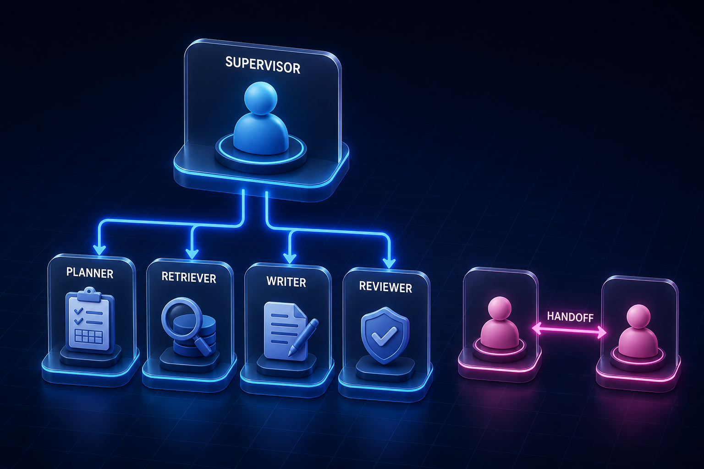

*"에이전트 하나로는 부족해서 4개를 붙였습니다. 그런데 서로 일을 떠넘기다가 40번째 호출에서야 끝났고, 비용은 예상의 8배가 나왔습니다."*


_중앙 수퍼바이저가 작업을 배분하고, 일부 에이전트는 직접 핸드오프로 이어받는 구조_

지난 7일차에서 에이전트를 **상태 머신**으로 그리는 법을 배웠다면, 오늘은 그 상태 머신이 **여러 개**일 때의 문제를 다룹니다. 에이전트를 늘리면 똑똑해지는 것처럼 보이지만, 실제로 늘어나는 것은 **호출 횟수와 책임의 공백**입니다.

---

## 🧭 1분 요약: 에이전트를 나누는 두 가지 방법

| 구조 | 결정권자 | 한 줄 비유 |
|---|---|---|
| **Supervisor** (수퍼바이저) | 중앙 관리자 1명 | 접수 간호사가 분과를 배정하는 병원 |
| **Swarm** (핸드오프) | 각 에이전트 본인 | 응급실 팀이 서로 직접 인계하는 방식 |

중요한 건 "어느 쪽이 더 좋다"가 아니라, **업무가 틀에 박혀 있는지 / 예측 불가능한지**에 따라 고르는 것입니다. 오늘은 두 구조를 같은 업무에 돌려서 **호출 수·토큰·종료 보장**을 숫자로 비교합니다.

---

## 🏥 일상 비유: 접수 간호사 vs 응급실 인계

**Supervisor는 대형 병원 접수대로**입니다. 환자가 오면 접수 간호사가 증상을 듣고 "내과 3번"처럼 진료과를 정해 줍니다. 진료과는 다른 과에 직접 환자를 넘기지 않고, 다시 접수대를 거칩니다.

- 장점: **누가 어디로 보냈는지 기록이 한 곳에 남습니다.** 문제가 생기면 접수대 기록만 보면 됩니다.
- 단점: 접수대가 바쁘면 전체가 밀립니다. 그리고 접수 간호사가 증상을 잘못 들으면 엉뚱한 과로 갑니다.

**Swarm은 응급실 인계**입니다. 응급실 의사가 "이건 흉부외과가 봐야겠네"라고 판단하면 **직접 그 과 의사에게 환자를 넘깁니다.** 빠르고 유연하지만, 인계가 여러 번 반복되면 "아직 아무도 최종 진단을 안 한" 상태로 밤을 새울 수 있습니다.

AI 에이전트 시스템에서 실제로 벌어지는 사고도 똑같습니다. **핸드오프 루프(handoff loop)** — A가 B에게, B가 다시 A에게 넘기면서 아무도 결론을 내지 않는 상태입니다.

---

## 👑 Supervisor 패턴: 결정을 한 곳에 모은다

수퍼바이저는 **"다음에 누가 일할지"만 결정**하고, 실제 작업은 전문 에이전트에게 맡깁니다.

```text
사용자 요청
   ↓
[Supervisor] ─→ Planner ─→ (결과)
   ↑__________________________|
   ├─→ Retriever ─→ (문서)
   ├─→ Writer ─→ (초안)
   └─→ Reviewer ─→ (검토) ─→ END
```

설계할 때 반드시 정해야 하는 세 가지:

1. **상태(State)**: 모든 에이전트가 공유하는 하나의 객체(계획·검색 결과·초안·검토 의견). LangGraph의 `StateGraph`가 이 역할을 합니다.
2. **라우팅 규칙**: 수퍼바이저가 고를 수 있는 다음 단계의 **닫힌 목록**(enum). 자유 텍스트로 "다음 담당자"를 뽑게 하면 존재하지 않는 에이전트 이름이 나옵니다.
3. **종료 조건**: `done`, `max_steps`, `예산 초과` 중 무엇이든 **숫자로 못 박은 상한**이 있어야 합니다.

**강점은 감사 가능성**입니다. "이 답변이 어디서 나왔나"를 물으면 수퍼바이저 로그 한 줄로 설명됩니다. 금융·의료처럼 **설명 책임**이 중요한 고객사에서 수퍼바이저를 기본값으로 두는 이유입니다.

---

## 🐝 Swarm 패턴: 에이전트끼리 직접 넘긴다

Swarm(스웜)은 수퍼바이저 없이 에이전트가 **다음 담당자를 스스로 정해 넘깁니다.** OpenAI의 Swarm/Agents SDK가 `handoff`라는 이름으로 대중화했고, CrewAI의 위임, AutoGen의 대화형 그룹도 같은 계열입니다.

핸드오프에는 두 가지가 함께 넘어갑니다.

- **대화 이력**(또는 그 요약)
- **권한/도구 세트**(이제 이 에이전트의 도구를 쓸 수 있다)

이 "권한이 따라간다"는 특성이 장점이자 위험입니다. 넘겨받은 에이전트가 **자기 도구로 할 수 있는 일**이 곧 사고 반경이 됩니다. 그래서 핸드오프 설계는 곧 **권한 설계**입니다(16일차 도구 화이트리스트와 같은 문제의식).

Swarm이 잘 맞는 업무는 **경로가 미리 정해지지 않은 탐색형 업무**입니다. 예: "이 계약서에서 문제 조항을 찾아라" — 법무가 보고, 재무가 보고, 다시 법무로 돌아가는 흐름을 미리 그릴 수 없습니다. 반대로 **정해진 5단계 정산 처리**에 Swarm을 쓰면, 굳이 자유도를 줄 이유가 없습니다.

---

## ⚖️ 선택 기준 표

| 기준 | Supervisor | Swarm |
|---|---|---|
| 업무 경로 | 미리 정의 가능 | 탐색적·가변적 |
| 감사·설명 책임 | ⭕ 로그 한 곳 | △ 분산됨 |
| 지연시간 | 중앙 라우팅 홉 추가 | 경로가 짧으면 유리 |
| 토큰 비용 | 상태를 한 곳에 모아 절약 | 인계마다 컨텍스트 복사 → 증가 |
| 실패 반경 | 수퍼바이저가 막아줌 | 무한 루프 위험 |
| 확장(에이전트 추가) | 라우팅 목록만 수정 | 각자 판단 규칙 수정 → 어려움 |

실무에서는 **하이브리드**가 가장 흔합니다. 큰 단계(계획 → 실행 → 검증)는 수퍼바이저가 지휘하고, "실행" 안에서만 에이전트끼리 인계합니다. 이렇게 하면 감사 로그는 유지하면서 탐색 유연성도 얻습니다.

---

## 🛡️ 멀티 에이전트 3대 안전장치

1. **Hop 예산(hop budget)**: 요청당 최대 인계 횟수를 정하고, 넘으면 **사람에게 에스컬레이션**합니다. "무한 루프"는 대개 예산이 없어서 생깁니다.
2. **인계 계약(handoff contract)**: 넘길 때 반드시 채워야 하는 필드(요청 요약, 지금까지 확인된 사실, 남은 과제, 실패한 시도)를 스키마로 강제합니다. 23일차 구조화 출력이 여기서 바로 쓰입니다.
3. **종료 판정자**: "끝났다"를 각 에이전트의 기분에 맡기지 말고, **별도 검증 단계**가 판정합니다. 검증 없이 끝내면 마지막 에이전트가 "잘 했습니다"라고 쓰고 종료됩니다.

---

## 💻 5분 실습: 같은 업무, 두 구조의 호출 수를 세어보자

4단계 업무(계획 → 검색 → 작성 → 검토)를 Supervisor와 Swarm에 각각 맡기고, **호출 횟수·토큰·종료 여부**를 비교합니다. 에이전트의 판단은 규칙으로 흉내 내므로 API 키 없이 바로 실행됩니다.

```python
# 4단계 업무. 각 단계는 전문 에이전트가 담당한다.
STEPS = ["planner", "retriever", "writer", "reviewer"]
CONTEXT_TOKENS = 1200   # 한 번 호출할 때 모델에 실려 나가는 평균 컨텍스트(누적 대화 포함)
CALL_LATENCY = 2.5      # 호출 1회 평균 지연(초). 시뮬레이션 값
MAX_STEPS = 12          # 안전장치: 이 횟수를 넘으면 사람에게 넘긴다


def supervisor_run():
    """중앙 수퍼바이저가 '아직 안 끝난 다음 단계'를 골라 배정한다."""
    log, done = [], set()
    for step in range(1, MAX_STEPS + 1):
        nxt = next((s for s in STEPS if s not in done), None)
        if nxt is None:
            log.append(("supervisor", "END"))
            return log, True
        log.append(("supervisor", f"assign->{nxt}"))
        log.append((nxt, "work"))
        done.add(nxt)
    return log, False


def swarm_run(max_hops=MAX_STEPS):
    """각 에이전트가 다음 담당자를 스스로 정해 직접 넘긴다."""
    log, current, rejects = [], "planner", 0
    for hop in range(1, max_hops + 1):
        log.append((current, "work"))
        # 인계 규칙 (검토가 두 번 반려하면 작성자에게 되돌린다 = 루프의 원인)
        if current == "planner":
            nxt = "retriever"
        elif current == "retriever":
            nxt = "writer"
        elif current == "writer":
            nxt = "reviewer"
        else:
            if rejects < 2:
                rejects += 1
                nxt = "writer"
            else:
                nxt = "END"
        log.append((current, f"handoff->{nxt}"))
        if nxt == "END":
            return log, True
        current = nxt
    return log, False


def report(name, log, finished):
    calls = len(log)
    tokens = calls * CONTEXT_TOKENS
    seconds = calls * CALL_LATENCY
    print(f"[{name}]")
    print(f"  종료: {'완료' if finished else '예산 초과 → 사람 에스컬레이션'}")
    print(f"  총 호출 {calls}회 / 토큰 약 {tokens:,}개 / 체감 소요 약 {seconds:.0f}초")
    print(f"  마지막 4단계: {log[-4:]}")
    print()


sup_log, sup_done = supervisor_run()
swarm_log, swarm_done = swarm_run()
report("Supervisor", sup_log, sup_done)
report("Swarm(핸드오프 루프 포함)", swarm_log, swarm_done)

diff = (len(swarm_log) - len(sup_log)) * CONTEXT_TOKENS
print(f"→ 같은 업무에서 Swarm이 추가로 쓴 토큰: 약 {diff:,}개")
print(f"→ Swarm 호출 수가 Supervisor의 약 {len(swarm_log) / len(sup_log):.1f}배")
```

**체감 포인트**: 4단계짜리 업무인데 **Supervisor는 9회, Swarm은 16회** 호출합니다. 검토자가 "다시 써오세요"라고 두 번 되돌린 결과입니다(작성·검토가 두 바퀴 더 돌면서 작업 4회 + 인계 4회가 추가). 여기서 봐야 할 것은 "Swarm이 나쁘다"가 아니라, **되돌림이 한 번 늘 때마다 작업 1회와 인계 1회, 곧 2,400토큰이 더 나간다**는 감각입니다. 실제 서비스에서 요청당 호출이 2배가 되면 지연시간과 비용이 동시에 2배가 되고, SLA(응답 3초)는 그 자리에서 깨집니다.

그래서 두 구조 모두에 **숫자로 된 상한**이 필요합니다. 위 코드의 `MAX_STEPS = 12`를 지우면 Swarm은 영원히 돌 수 있고, 그 무한 루프가 새벽 3시에 돌면 다음 날 아침 청구서로 돌아옵니다.

---

## ⚠️ 자주 하는 실수 3가지

1. **에이전트 수를 조직도처럼 정함**: "우리 팀이 3개니까 에이전트도 3개"는 근거가 아닙니다. 기준은 **도구 개수와 권한 경계**입니다. 한 에이전트가 가진 도구가 10개를 넘고 판단이 흐려지면 쪼개고, 3개로 충분하면 합칩니다.
2. **컨텍스트를 통째로 복사**: 인계마다 전체 대화를 복사하면 에이전트 수만큼 토큰이 곱해집니다. **요약 + 구조화된 사실 카드**만 넘기세요.
3. **수퍼바이저의 결정을 검증하지 않음**: 수퍼바이저가 "reviewer 생략"을 결정해도 아무도 막지 않으면, 검증 없는 답변이 고객에게 갑니다. 라우팅 결정도 **정책 엔진**으로 한 번 더 거르세요.

---

## 🎯 Solution Architect 관점 한 줄 요약
> **"멀티 에이전트의 품질은 에이전트 수가 아니라 '인계 계약'과 'hop 예산'으로 결정된다."**
>
> 고객 미팅에서 이 주제가 나오면 대개 "에이전트를 몇 개로 나눌까요?"라고 묻습니다. SA의 답은 개수가 아니라 **실패했을 때 누가 멈추는가**입니다. 후속 질문은 보통 세 가지입니다. ① 인계가 무한히 반복되면 무엇이 멈추는가 ② 에이전트별 권한은 어떻게 분리했는가 ③ 장애 시 어느 단계까지 되돌릴 수 있는가. 이 세 질문에 그림으로 답하면 "데모용 에이전트"가 아니라 **운영 가능한 시스템**으로 평가받습니다.
