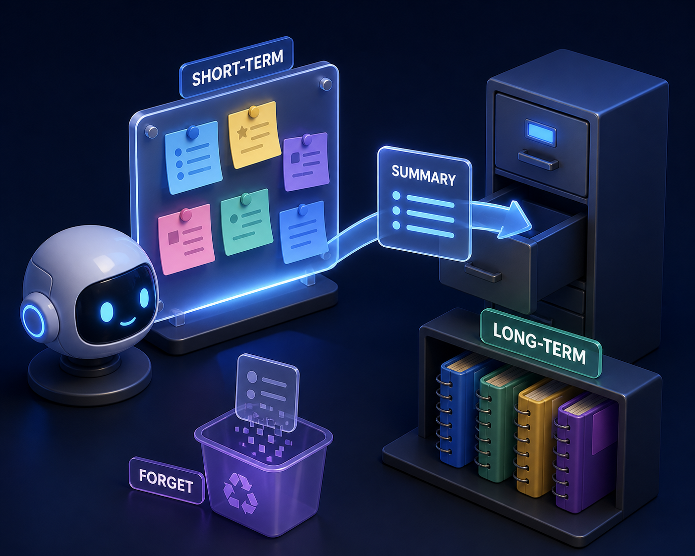

이런 상황을 떠올려 보세요.

*"어제 '예산은 300만원'이라고 알려줬는데, 오늘 다시 물으니 '예산이 얼마였죠?'라고 되묻습니다. 대화가 30턴만 길어져도 우리 챗봇은 기억상실증이 됩니다."*


_단기 화이트보드의 요약이 장기 메모리로 승격되고, 오래된 기억은 폐기된다_

모델은 **우리가 보내지 않은 것을 기억하지 못합니다.** "기억해 줘"라고 프롬프트에 써도, 다음 요청에 그 문장이 없으면 없는 것입니다. 그래서 에이전트의 기억은 마법이 아니라 **설계**입니다. 오늘은 대화 30턴에서 **무엇을 남기고 무엇을 버릴지**를 숫자로 비교합니다.

---

## 🧠 일상 비유: 화이트보드와 수첩

회의실을 떠올려 보세요.

- **화이트보드** = 지금 진행 중인 회의의 임시 메모. 회의가 끝나면 **지웁니다**. (단기 컨텍스트)
- **수첩** = 결정 사항, 담당자, 다음 할 일. 회의가 끝나도 **남습니다**. (장기 메모리)

여기서 초보자가 놓치는 두 가지가 있습니다.

1. **화이트보드를 안 지우면** 다음 회의를 시작할 자리가 없습니다. (컨텍스트 윈도 초과 → 오래된 대화부터 잘림)
2. **수첩에 다 적으면** 수첩을 다시 읽는 데 회의만큼 시간이 걸립니다. (장기 메모리 검색 비용 → 결국 또 느려짐)

기억 설계의 핵심 질문은 "얼마나 많이 기억할까"가 아니라 **"무엇을 어디에 적을까"** 입니다.

---

## 🗂️ 메모리 4계층

| 계층 | 담당 | 저장 위치 | 수명 |
|---|---|---|---|
| **작업 기억(Working)** | 지금 이 요청의 문맥 | 프롬프트(컨텍스트 윈도) | 요청 1회 |
| **대화 기억(Episodic)** | 이 세션의 흐름, 이전 결정 | 요약본 + 최근 N턴 | 세션~며칠 |
| **사실 기억(Semantic)** | 사용자 프로필·선호·제약 | DB/벡터 스토어 | 지속(사용자 삭제 시까지) |
| **절차 기억(Procedural)** | "이 업무는 이 순서로" | 프롬프트·워크플로 정의 | 배포 단위 |

실무에서 가장 많이 새는 곳은 **2번과 3번의 경계**입니다. 대화 요약(2번)을 장기 기억(3번)처럼 쓰면, 세션이 바뀔 때 사라집니다. 반대로 잡담까지 전부 3번에 넣으면, 검색 결과에 "오늘 날씨 얘기"가 섞여 나옵니다.

---

## ✍️ 쓰기 정책(Write Policy): 무엇을 기억할지 정한다

기억은 **쓰는 순간** 결정됩니다. 에이전트가 대화 중에 아래 신호를 보면 장기 기억에 **구조화해서** 저장합니다.

| 신호 | 저장할 것 | 예 |
|---|---|---|
| 제약·조건 | 변경 불가 조건 | "땅콩 알레르기", "예산 300만원" |
| 선호 | 반복 적용할 선택 | "사이즈 M", "오전 미팅 선호" |
| 확정 사실 | 이후 판단의 근거 | "계약은 12월 1일 시작" |
| 교정 | 이전 답의 수정 | "그거 300이 아니라 350이야" |

저장할 때는 **원문 문장이 아니라 슬롯**으로 넣으세요. `"예산은 300만원이야"`를 그대로 넣으면 나중에 "350만원"이 와도 두 문장이 공존합니다. `{budget: 3000000, currency: "KRW", updated_at: ...}`로 넣으면 **덮어쓰기**가 됩니다. (23일차 구조화 출력이 여기서 다시 쓰입니다.)

**쓰지 말아야 할 것**도 정해야 합니다. 비밀번호·주민번호 같은 민감정보, 일회성 잡담, 모델이 추측한 내용(사용자가 말하지 않은 것). 특히 **모델이 만들어낸 요약을 사실로 저장**하면, 환각이 영구 기억이 됩니다. 이걸 **메모리 오염(memory poisoning)** 이라고 부릅니다.

---

## 🔎 읽기 정책(Read Policy): 언제 꺼낼지 정한다

장기 기억을 **매 요청마다 전부 붙이면** 컨텍스트가 터집니다. 그래서 검색해서 가져옵니다.

1. **항상 붙이는 것**: 사용자 프로필의 핵심 3~5줄(이름, 언어, 제약). 작고 늘 필요합니다.
2. **검색해서 붙이는 것**: 현재 질문과 관련된 과거 사실·결정. 벡터 검색 + 리랭킹(12일차).
3. **절대 안 붙이는 것**: 만료된 기억, 다른 사용자·다른 테넌트의 기억(13일차 격리).

읽기에서도 순서가 중요합니다. 프로필 → 관련 기억 → 최근 대화 순으로 넣고, **가장 최근 지시가 가장 강하게** 작동하도록 배치합니다.

---

## ⏳ 잊는 설계(Forgetting): 기억은 부채다

기억은 쌓을수록 좋아지는 자산이 아니라 **갱신·삭제 책임이 붙는 부채**입니다.

- **TTL**: "이번 주만 유효"한 기억(임시 프로젝트, 여행 일정)에는 만료일을 붙입니다.
- **충돌 해결**: 같은 슬롯에 새 값이 오면 **최신 우선 + 이전 값은 이력으로**. 이력이 없으면 "왜 바뀌었나"를 설명할 수 없습니다.
- **삭제 요청**: "내 정보 지워줘"는 **프로필·요약·벡터 인덱스 전부**에서 지워야 합니다. 요약본에 남아 있으면 지운 게 아닙니다. (27일차 거버넌스와 직결)

---

## 💻 5분 실습: 30턴 대화, 세 가지 기억 전략 비교

같은 30턴 대화를 ① 전부 붙이기 ② 최근 8턴만 ③ 요약+사실 카드로 각각 처리하고, **토큰·누적 비용·핵심 사실 기억률**을 비교합니다. 핵심 사실 4개는 2·7·12·18턴에 숨어 있습니다.

```python
FACTS = {
    2: "내 이름은 지민이야",
    7: "예산은 300만원이야",
    12: "땅콩 알레르기가 있어",
    18: "사이즈는 M을 선호해",
}
CHECK_KEYS = ["지민", "300만원", "땅콩", "M"]      # 마지막에 확인할 핵심 사실
PRICE_PER_TOKEN = 3.0 / 1_000_000                  # 입력 100만 토큰당 3달러 가정

turns = [
    FACTS.get(n, f"{n}번째 대화: 어제 회의 자료와 오늘 공유된 문서를 비교하고, 다음 주 일정도 정리해 줄 수 있어?")
    for n in range(1, 31)
]


def tokens(text):
    """한국어 근사치: 글자 수 × 0.8 (정확한 토크나이저 대신 비교용으로 사용)"""
    return int(len(text) * 0.8) + 1


def strategy_full():
    """① 전부 붙이기: 기억률 100%, 비용은 턴마다 증가"""
    return "\n".join(turns)


def strategy_window(size=8):
    """② 최근 N턴만: 비용은 일정, 오래된 사실은 사라짐"""
    return "\n".join(turns[-size:])


def compact_upto(end):
    """③ 요약 + 사실 카드: 8턴마다 잡담은 한 줄 요약으로, 사실은 문장 그대로 승격"""
    memory, digest, buf = [], [], []
    for i, t in enumerate(turns[:end], 1):
        buf.append(t)
        if len(buf) >= 8:
            digest.append(f"[요약] {i - 7}~{i}턴 잡담 정리")
            for j in range(i - len(buf) + 1, i + 1):
                if j in FACTS:
                    memory.append(FACTS[j])
            buf = []
    return "\n".join(digest + memory + buf)


def recall(context):
    return sum(1 for key in CHECK_KEYS if key in context)


def cumulative(fn):
    """30턴 세션 전체에서 모델에 실제로 보낸 입력 토큰 합계"""
    return sum(tokens(fn(i)) for i in range(1, 31))

rows = [
    ("전체 이력 그대로", strategy_full(), cumulative(lambda i: "\n".join(turns[:i]))),
    ("최근 8턴만(슬라이딩)", strategy_window(), 30 * tokens(strategy_window())),
    ("요약 + 사실 카드", compact_upto(30), cumulative(compact_upto)),
]

print(f"{'전략':<20}{'최종턴 토큰':>10}{'기억 x/4':>9}{'30턴 누적':>10}{'비용($)':>9}")
for name, ctx, cum in rows:
    print(f"{name:<20}{tokens(ctx):>10}{recall(ctx):>9}{cum:>10,}{cum * PRICE_PER_TOKEN:>9.4f}")

full_cum = rows[0][2]
compact_cum = rows[2][2]
print()
print(f"→ 요약 방식은 전체 이력 대비 입력 토큰 {(1 - compact_cum / full_cum) * 100:.0f}% 절감")
print(f"→ 슬라이딩 창은 저렴하지만 핵심 사실 4개 중 {recall(strategy_window())}개만 기억")
```

**실행 결과**

```text
전략                      최종턴 토큰   기억 x/4    30턴 누적    비용($)
전체 이력 그대로                 1217        4    17,970   0.0539
최근 8턴만(슬라이딩)               365        0    10,950   0.0329
요약 + 사실 카드                 352        4     5,376   0.0161

→ 요약 방식은 전체 이력 대비 입력 토큰 70% 절감
→ 슬라이딩 창은 저렴하지만 핵심 사실 4개 중 0개만 기억
```

**체감 포인트**: 세 전략의 최종 턴 토큰은 1,217 / 365 / 352입니다. "요약 + 사실 카드"가 **가장 저렴한데 기억률은 100%** 입니다. 마법이 아니라 **잡담을 버리고 사실만 승격**했기 때문입니다.

반대로 "최근 8턴만"은 365토큰을 쓰고도 **핵심 사실을 하나도 기억하지 못합니다.** 18턴의 "사이즈 M"이 23턴부터 사라지니까요. 여기서 배울 것은 **비용을 줄이는 방법이 곧 기억을 늘리는 방법**이라는 점입니다. 컨텍스트를 줄이려면 요약해야 하고, 요약하려면 무엇이 중요한지 정해야 합니다.

그리고 전체 이력 방식의 진짜 비용은 마지막 턴이 아니라 **누적**에 있습니다. 30턴 세션에서 17,970토큰, 요약 방식 5,376토큰. 이게 하루 수천 세션에 곱해지면 월 비용 차이가 **자릿수**로 벌어집니다.

---

## ⚠️ 자주 하는 실수 3가지

1. **요약을 사실로 신뢰**: 모델이 만든 요약에 "고객이 환불을 원함"이 들어갔는데 실제로는 "환불 정책을 물어봤을 뿐"일 수 있습니다. 요약은 **압축된 추측**입니다. 중요한 사실은 원문 근거 ID와 함께 저장하세요.
2. **장기 기억을 매 요청마다 전부 주입**: 사용자당 기억이 200개쯤 쌓이면 컨텍스트가 터지고 비용이 급증합니다. **프로필 5줄 + 검색된 5개**가 기본값입니다.
3. **사용자 간 기억 격리 누락**: 메모리 검색에서 `user_id` 필터를 빠뜨리면 다른 고객의 선호가 답변에 섞입니다. 13일차 멀티테넌시와 **완전히 같은 사고**입니다.

---

## 🎯 Solution Architect 관점 한 줄 요약
> **"에이전트 메모리는 '얼마나 기억하나'가 아니라 '무엇을 쓰고, 무엇을 언제 지우는가'의 정책 문제다."**
>
> 고객은 늘 "우리 고객을 기억하는 챗봇"을 원하지만, 그 요구의 뒷면에는 **개인정보 보관 기간·삭제 요청·테넌트 격리**가 붙어 있습니다. 후속 질문 셋: ① 사용자가 삭제를 요청하면 어디까지 지워지는가 ② 기억이 틀렸을 때 누가 고치는가 ③ 요약본에 민감정보가 남지 않는다는 것을 어떻게 증명하는가. 이 셋에 답하지 못하는 개인화 데모는 **보안 검토에서 멈춥니다.** 메모리 설계는 개인화 기능이 아니라 **데이터 거버넌스의 일부**로 제안해야 통과합니다.
