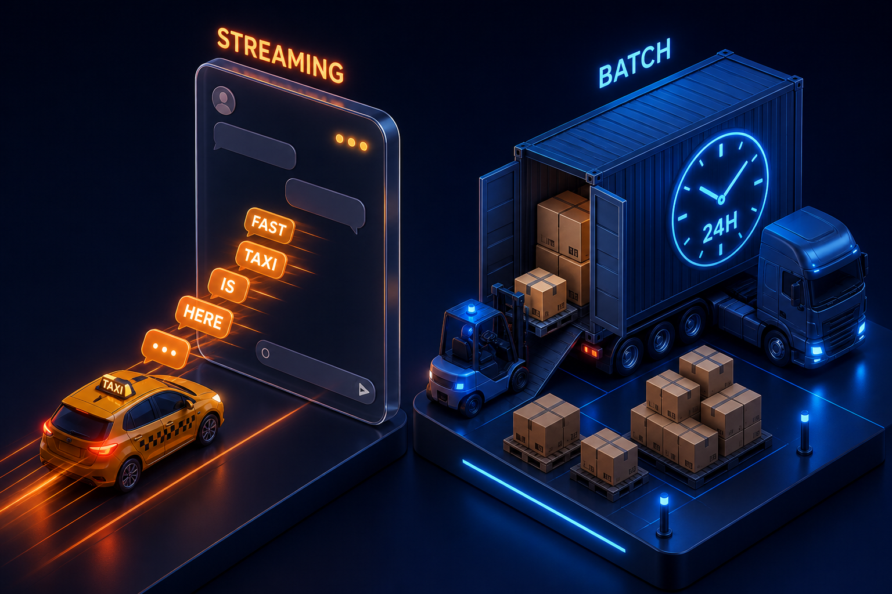

이런 상황을 떠올려 보세요.

*"같은 1만 건인데, 한쪽은 73분 동안 화면을 붙잡고 73달러를 썼고, 다른 쪽은 다음 날 아침 결과를 받고 37달러를 냈습니다. 처리한 일은 똑같습니다."*


_즉시 응답하는 스트리밍 경로와 야간에 몰아 처리하는 배치 경로_

LLM 비용 논의는 대개 "어떤 모델을 쓰나"에서 멈춥니다. 그런데 실제 청구서를 바꾸는 건 **언제, 어떤 방식으로 호출하나**입니다. 오늘은 **실시간(스트리밍)** 과 **배치** 의 차이를 숫자로 비교하고, 둘을 섞는 설계를 다룹니다.

---

## 🚕 일상 비유: 택시와 야간 화물 트럭

- **택시(실시간)**: 지금 당장, 내가 원하는 시간에, 문 앞까지. 비싸고 효율은 낮습니다(빈 차로 돌아다님).
- **화물 트럭(배치)**: 짐을 모아 밤에 한 번에. 싸지만 **오늘 밤 떠나면 내일 도착**합니다.

선택 기준은 하나입니다. **"이 결과가 5분 안에 필요한가?"**
고객 문의 요약은 5분 안에 필요합니다(택시). 지난달 계약서 1만 건 분류는 내일 아침이면 충분합니다(트럭).

---

## ⏱️ 지연을 두 개로 쪼개기: TTFT와 총 시간

스트리밍을 이해하려면 지연을 두 값으로 나눠야 합니다.

| 지표 | 의미 | 사용자 체감 |
|---|---|---|
| **TTFT** (Time To First Token) | 요청 후 **첫 글자**까지 | "반응이 오나?" |
| **총 완성 시간** | 마지막 글자까지 | "언제 다 읽나?" |

500토큰짜리 답변을 예로 들면, 완성까지 11.7초가 걸려도 **첫 글자가 0.6초**에 나오면 사용자는 "빠르다"고 느낍니다. 반대로 같은 11.7초를 빈 화면으로 기다리면 "멈췄나?" 하고 새로고침합니다. **체감 지연의 대부분은 TTFT**입니다.

> 스트리밍은 총 시간을 줄이지 않습니다. **대기하는 느낌**을 줄입니다. 이 차이를 모르면 "스트리밍 켰는데 왜 느리냐"는 문의를 받습니다.

---

## 📦 배치가 싼 이유 (그리고 싸게 못 쓰는 경우)

배치 API는 요청을 **파일에 모아 제출하고, 결과 파일을 받는** 방식입니다. 제공사 입장에서는 GPU를 유휴 시간에 몰아 쓸 수 있으니 **비용을 크게 깎아 줍니다**(주요 제공사 모두 대략 절반 수준의 단가).

| 배치가 유리 | 배치가 불리 |
|---|---|
| 대량 분류·태깅·요약 | 대화형 챗봇 |
| 야간 리포트·정산 | 실시간 알림·모니터링 |
| 평가(Evals) 데이터셋 채점 | 사람이 승인을 기다리는 워크플로 |
| 문서 마이그레이션·백필 | 첫 응답 3초 SLA가 있는 기능 |

주의할 점: 배치는 **"제출 → 처리 → 수집"의 3단계**이고, 각 단계에 실패 지점이 있습니다. 제출 파일이 깨졌는지, 일부 항목만 실패했는지, 결과가 순서와 무관하게 오는지(요청 ID로 매핑해야 함)를 설계에 넣어야 합니다. **배치는 "싼 대신 운영이 늘어나는" 선택**입니다.

---

## 🔀 처리량(Throughput)과 한도(Rate Limit)

실시간 경로의 벽시계 시간은 모델 속도가 아니라 **동시성과 한도**가 결정합니다.

```text
소요 시간 = max( 문서 수 ÷ 동시 호출 수 × 호출당 시간,  문서 수 ÷ 분당 한도 × 60초 )
```

예를 들어 동시 8개, 호출당 3.5초면 1만 건에 **73분**입니다. 여기서 동시성을 64로 올리면 9분이 되지만, **분당 요청 한도(RPM)** 가 1,000이면 10분 벽에 부딪힙니다. 즉, 동시성을 무작정 올려도 **한도가 상한**입니다.

한도에 부딪히면 429가 쏟아지고, 재시도가 겹치면 **큐가 무너집니다**. 그래서 대량 작업은 대개 **큐 + 워커 + 백프레셔** 구조로 가고, 그 큐의 야간분을 배치로 넘깁니다.

---

## 💻 5분 실습: 1만 건을 세 가지 방식으로 처리해 보자

같은 1만 건을 ① 전부 실시간 ② 전부 배치 ③ 긴급 5%만 실시간(하이브리드)으로 처리하고 **비용·벽시계 시간**을 비교합니다. 마지막에 스트리밍의 체감 대기 효과도 계산합니다.

```python
DOCS = 10_000
IN_TOK, OUT_TOK = 1_200, 250                     # 문서 1건당 입력·출력 토큰
PRICE_IN, PRICE_OUT = 3.0 / 1_000_000, 15.0 / 1_000_000   # 달러/토큰 (예시 단가)
BATCH_DISCOUNT = 0.5                             # 배치 할인율(절반)
CONCURRENCY = 8                                  # 실시간 동시 호출 수
CALL_SECONDS = 3.5                               # 호출 1건 소요(초)
RPM_LIMIT = 1_000                                # 분당 요청 한도


def wall_minutes(docs, concurrency=CONCURRENCY, seconds=CALL_SECONDS, limit=RPM_LIMIT):
    """동시성과 분당 한도 중 더 빡빡한 쪽이 벽시계 시간을 결정한다."""
    by_concurrency = docs / concurrency * seconds
    by_quota = docs / limit * 60
    return max(by_concurrency, by_quota) / 60


def cost(docs, discount=0.0):
    per_doc = IN_TOK * PRICE_IN + OUT_TOK * PRICE_OUT
    return docs * per_doc * (1 - discount)


per_doc = IN_TOK * PRICE_IN + OUT_TOK * PRICE_OUT
print(f"문서 1건 단가: ${per_doc:.5f}")
print(f"1만 건 실시간 ${cost(DOCS):.2f} / 배치 ${cost(DOCS, BATCH_DISCOUNT):.2f}")
print()

urgent = int(DOCS * 0.05)
bulk = DOCS - urgent
modes = [
    ("전부 실시간", cost(DOCS), f"{wall_minutes(DOCS):.0f}분", "즉시~몇 분"),
    ("전부 배치", cost(DOCS, BATCH_DISCOUNT), "최대 24시간", "다음 날 확인"),
    ("하이브리드 5%", cost(urgent) + cost(bulk, BATCH_DISCOUNT), f"{wall_minutes(urgent):.0f}분", "긴급만 즉시"),
]

print(f"{'모드':<14}{'비용($)':>9}{'벽시계':>10}{'사용자 체감':>14}")
for name, c, t, feel in modes:
    print(f"{name:<14}{c:>9.2f}{t:>10}{feel:>14}")

hybrid = cost(urgent) + cost(bulk, BATCH_DISCOUNT)
print()
print(f"→ 하이브리드는 전부 실시간 대비 ${cost(DOCS) - hybrid:.2f} 절약 "
      f"({(1 - hybrid / cost(DOCS)) * 100:.0f}%)")

# 스트리밍 체감: 총 시간은 같지만 '첫 글자'가 먼저 온다
TTFT, SPEED = 0.6, 45          # 첫 토큰 0.6초, 이후 초당 45토큰
ANSWER_TOKENS = 500
print(f"→ 500토큰 답변: 첫 글자 {TTFT:.1f}초, 완성 {TTFT + ANSWER_TOKENS / SPEED:.1f}초 "
      f"(같은 시간을 빈 화면으로 기다리면 '멈췄나?'가 됩니다)")
```

**실행 결과**

```text
문서 1건 단가: $0.00735
1만 건 실시간 $73.50 / 배치 $36.75

모드                비용($)       벽시계        사용자 체감
전부 실시간            73.50       73분        즉시~몇 분
전부 배치             36.75   최대 24시간       다음 날 확인
하이브리드 5%          38.59        4분        긴급만 즉시

→ 하이브리드는 전부 실시간 대비 $34.91 절약 (48%)
→ 500토큰 답변: 첫 글자 0.6초, 완성 11.7초 (같은 시간을 빈 화면으로 기다리면 '멈췄나?'가 됩니다)
```

**체감 포인트**: 하이브리드는 **비용은 거의 배치(38.59 vs 36.75)** 인데, 긴급 5%는 **4분 안에** 끝납니다. 이게 "전부 실시간"과 "전부 배치" 사이에서 고객을 설득하는 숫자입니다.

여기서 조심할 것: 73분은 **모델이 느려서**가 아니라 **동시 8개 제약** 때문입니다. 동시성을 64로 올리면 9분이 되지만, 한도(RPM)를 1,000으로 두면 10분이 상한입니다. 즉 **실시간 경로의 처리량은 아키텍처(동시성·한도·큐)로 결정**되고, 그 상한을 넘는 일은 배치로 보내야 합니다.

---

## ⚠️ 자주 하는 실수 3가지

1. **모든 요청을 스트리밍으로**: 스트리밍은 **후처리 필터와 충돌**합니다. 개인정보 마스킹·금칙어 검사(27일차)를 마친 뒤 내보내야 하는데, 스트리밍은 토큰을 즉시 흘립니다. 민감 응답은 **버퍼링 후 전송**으로 분리하세요.
2. **배치를 "그냥 싼 API"로 취급**: 순서 보장이 없고, 부분 실패가 흔하며, 결과 수집 지연이 있습니다. **요청 ID 매핑·재처리 큐·결과 검증**이 없으면 조용히 절반이 누락됩니다.
3. **한도 계산을 빼먹음**: 문서 수만 보고 "동시성 올리면 되지"라고 하면 429 지옥을 만납니다. **RPM·TPM·동시성 중 최솟값**이 실제 처리량입니다.

---

## 🎯 Solution Architect 관점 한 줄 요약
> **"AI 비용의 절반은 모델 선택이 아니라 '호출 방식'에서 결정된다."**
>
> 고객 PoV에서 이 질문은 늘 비용 견적과 함께 옵니다. 후속 질문 셋: ① 실시간이 꼭 필요한 요청은 전체의 몇 %인가 ② 배치 결과가 늦었을 때 업무가 멈추는가 ③ 스트리밍 응답에 보안 필터를 어떻게 적용하는가. 이 셋에 답하면 "토큰 단가표"가 아니라 **업무 흐름을 이해한 견적**으로 평가받습니다. 반대로 전부 실시간으로 견적을 내면, 첫 달 청구서에서 예산이 깨집니다.
