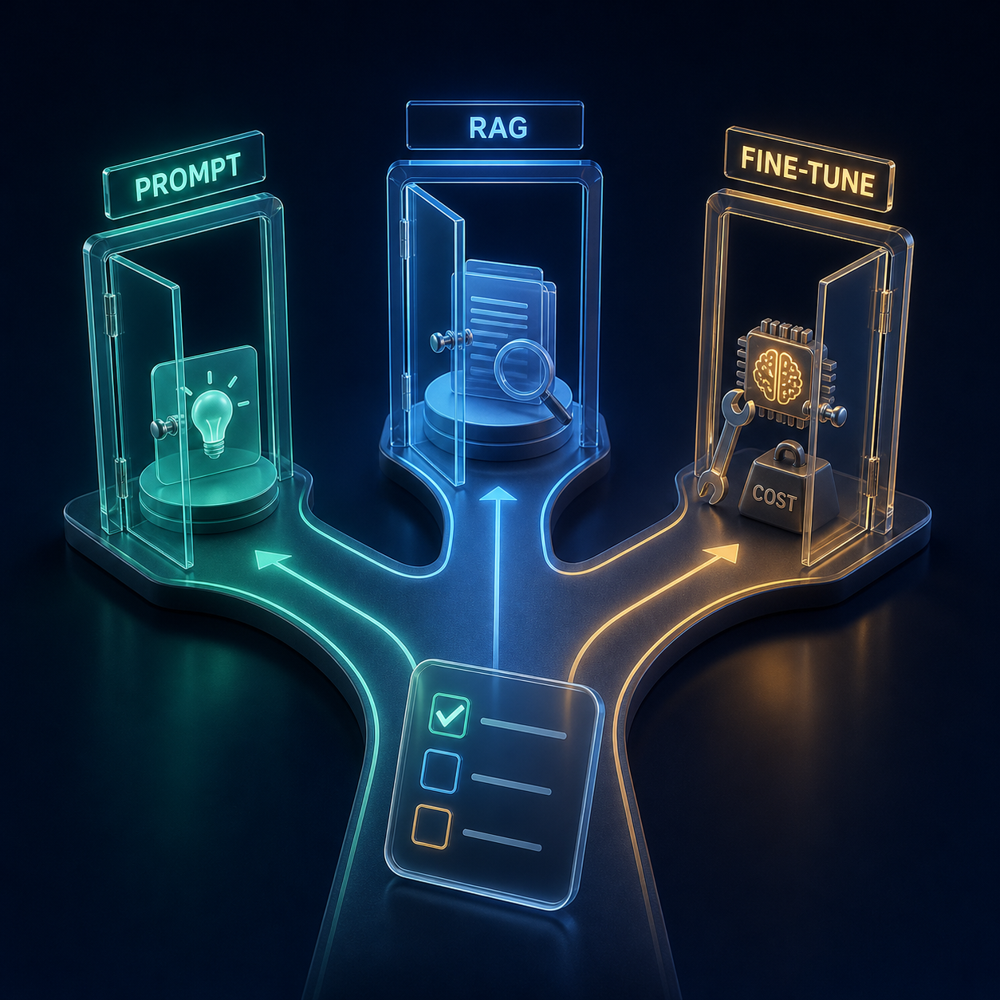

*"고객이 물었습니다. 'RAG로 하면 되죠?' 옆에서 다른 팀장이 '우리는 파인튜닝 견적을 이미 받아봤습니다'라고 했습니다. 두 말 다 틀리지 않았고, 두 말 다 근거가 없었습니다."*


_프롬프트·RAG·파인튜닝 세 갈래 중 요구사항 가중치로 길을 고른다_

세 가지 방법은 **경쟁 관계가 아니라 역할이 다릅니다.** 그런데 실무에서는 "요즘은 RAG죠" 같은 유행으로 결정되고, 그 결정이 6개월 뒤 유지보수 지옥으로 돌아옵니다. 오늘은 **요구사항 가중치로 세 방식을 점수화**해서, 회의에서 쓸 수 있는 근거를 만듭니다.

---

## 🍳 일상 비유: 레시피 · 냉장고 · 셰프 재교육

| 방법 | 비유 | 무엇을 바꾸나 |
|---|---|---|
| **프롬프트** | 레시피 종이를 더 자세히 쓴다 | 지시문 |
| **RAG** | 요리할 때 **냉장고에서 재료를 꺼내 온다** | 참고 자료(지식) |
| **파인튜닝** | 셰프를 **다시 교육시킨다** | 손버릇(행동·형식) |

여기서 결정적인 차이: **냉장고는 재료를 바꾸면 바로 반영**되지만, 셰프를 다시 교육시키면 **다음 달에나** 새 손버릇이 나옵니다. 그리고 셰프 교육에는 **교재(라벨링 데이터)를 사람이 만들어야** 합니다.

> 한 줄 원칙: **"지식은 냉장고(RAG), 행동은 교육(파인튜닝), 지시는 레시피(프롬프트)."**

---

## 🧭 세 방법이 잘하는 일 / 못하는 일

| 기준 | 프롬프트 | RAG | 파인튜닝 |
|---|---|---|---|
| 최신 정보 반영 | △ 붙여 넣으면 됨 | ⭕ 문서만 갱신 | ❌ 재학습 필요 |
| 출처 인용 | △ | ⭕ 근거 ID | ❌ 없음 |
| 출력 형식·톤 일관성 | △ 예시 의존 | △ | ⭕ 가장 강함 |
| 내부 지식 대량 암기 | ❌ | ⭕ | ⭕ (비용 큼) |
| 초기 비용 | ⭕ 거의 0 | △ 인덱싱·검색 구축 | ❌ 라벨링·학습·평가 |
| 지연·토큰 절감 | △ | ❌ 컨텍스트 증가 | ⭕ 짧은 프롬프트로 가능 |
| 유지보수 | ⭕ 문장 수정 | ⭕ 문서 갱신 | ❌ 재학습 주기 |
| 데이터 삭제 요청 | ⭕ 쉬움 | ⭕ 인덱스에서 삭제 | ❌ 학습 데이터에서 지우기 어려움 |

마지막 줄이 SA에게 중요합니다. **파인튜닝된 모델은 "삭제"가 어렵습니다.** 고객이 "내 정보로 학습된 모델에서 나를 지워 달라"고 하면, 재학습이 답입니다. 이 한 줄이 금융·의료 고객의 선택을 바꿉니다.

---

## 📊 비용 구조를 숫자로

정확한 단가는 벤더·모델·시점마다 다르므로, **구조**만 기억하면 됩니다.

| 항목 | 프롬프트 | RAG | 파인튜닝 |
|---|---|---|---|
| 초기 | 0 | 인덱싱·검색 인프라 구축 | **라벨링 데이터 구축(가장 큼)** + 학습 |
| 매 요청 | 토큰(입력+출력) | 토큰 + **검색 지연·인프라** | 토큰(짧아짐) + 전용 모델 호스팅 |
| 갱신 | 즉시 | 문서 갱신 후 재인덱싱 | **재학습(주 단위)** |
| 실패 시 되돌리기 | 쉬움 | 쉬움 | 어려움(모델 교체) |

실무에서 실제로 돈이 드는 곳은 **토큰이 아니라 라벨링 인건비**입니다. 1,000건의 고품질 학습 데이터를 만들려면 도메인 전문가가 붙어야 하고, 그 비용이 몇 달치 토큰보다 큽니다.

---

## 🚦 의사결정 순서 (실무 표준)

1. **프롬프트 + 좋은 모델로 먼저 해본다** (1~2일). 여기서 80%가 해결됩니다.
2. **지식이 부족하면 RAG** (1~2주). 최신성·인용·삭제 요구가 있으면 거의 항상 RAG.
3. **형식·톤이 흔들리거나 지연·비용이 문제면 파인튜닝** (1~3개월). 이때도 RAG를 유지하는 경우가 많습니다(RAG + FT 조합).
4. **모든 단계에서 같은 골든셋으로 평가** (11일차). 방식이 바뀌면 **같은 시험지**로 비교해야 합니다.

---

## 💻 5분 실습: 요구사항 가중치로 세 방식을 점수화하기

세 가지 시나리오(사내 규정 Q&A / 계약서→요약표 변환 / 브랜드 카피 톤)에 대해 요구사항 가중치를 넣고, 세 방식의 적합도를 **0~5점으로 계산**합니다. 데이터 학습이 금지된 시나리오에서는 파인튜닝을 **하드 게이트로 제외**합니다.

```python
CRITERIA = ["최신성", "내부 지식 암기", "형식·톤 일관성", "초기 비용 절감",
            "낮은 지연", "유지보수 용이", "데이터 통제"]

# (요구가 0일 때 점수, 요구가 5일 때 점수)
# → 요구가 강할수록 그 방식이 얼마나 유리해지는지를 나타낸다
FIT = {
    "프롬프트": {
        "최신성": (3, 2), "내부 지식 암기": (2, 1), "형식·톤 일관성": (3, 2),
        "초기 비용 절감": (5, 5), "낮은 지연": (4, 4),
        "유지보수 용이": (5, 5), "데이터 통제": (4, 3),
    },
    "RAG": {
        "최신성": (2, 5), "내부 지식 암기": (2, 4), "형식·톤 일관성": (3, 3),
        "초기 비용 절감": (4, 2), "낮은 지연": (3, 2),
        "유지보수 용이": (4, 3), "데이터 통제": (4, 4),
    },
    "파인튜닝": {
        "최신성": (2, 1), "내부 지식 암기": (2, 5), "형식·톤 일관성": (3, 5),
        "초기 비용 절감": (3, 1), "낮은 지연": (4, 5),
        "유지보수 용이": (4, 1), "데이터 통제": (3, 2),
    },
}

SCENARIOS = {
    "사내 규정 Q&A": {
        "weights": {"최신성": 5, "내부 지식 암기": 4, "형식·톤 일관성": 2,
                    "초기 비용 절감": 3, "낮은 지연": 4,
                    "유지보수 용이": 4, "데이터 통제": 5},
        "ft_allowed": False,          # 고객 데이터를 학습에 쓸 수 없다는 계약 조건
    },
    "계약서→요약표 변환": {
        "weights": {"최신성": 2, "내부 지식 암기": 4, "형식·톤 일관성": 5,
                    "초기 비용 절감": 2, "낮은 지연": 3,
                    "유지보수 용이": 2, "데이터 통제": 4},
        "ft_allowed": True,
    },
    "브랜드 카피 톤": {
        "weights": {"최신성": 2, "내부 지식 암기": 2, "형식·톤 일관성": 5,
                    "초기 비용 절감": 5, "낮은 지연": 4,
                    "유지보수 용이": 4, "데이터 통제": 3},
        "ft_allowed": True,
    },
}


def fit(option, criterion, need):
    """need(0~5)가 커질수록 그 방식이 얼마나 유리한지 선형 보간."""
    low, high = FIT[option][criterion]
    return low + (high - low) * need / 5


for name, spec in SCENARIOS.items():
    weights = spec["weights"]
    total_weight = sum(weights.values())
    print(f"[{name}]")
    scores = {}
    for option in FIT:
        if option == "파인튜닝" and not spec["ft_allowed"]:
            print(f"  {option:<6} 제외 — 데이터 학습 불가(하드 게이트)")
            continue
        scores[option] = sum(w * fit(option, c, w) for c, w in weights.items()) / total_weight
    for option, score in sorted(scores.items(), key=lambda x: -x[1]):
        print(f"  {option:<6} {score:.2f}")
    best, second = sorted(scores, key=scores.get, reverse=True)[:2]
    margin = scores[best] - scores[second]
    print(f"  → 추천: {best} / 2위 {second}, 차이 {margin:.2f}")
    if margin < 0.3:
        print("  → 차이가 작으니 더 싸고 되돌리기 쉬운 쪽부터 PoV로 검증")
    print()
```

**실행 결과**

```text
[사내 규정 Q&A]
  파인튜닝   제외 — 데이터 학습 불가(하드 게이트)
  RAG    3.53
  프롬프트   3.19
  → 추천: RAG / 2위 프롬프트, 차이 0.35

[계약서→요약표 변환]
  파인튜닝   3.56
  RAG    3.30
  프롬프트   2.95
  → 추천: 파인튜닝 / 2위 RAG, 차이 0.26
  → 차이가 작으니 더 싸고 되돌리기 쉬운 쪽부터 PoV로 검증

[브랜드 카피 톤]
  프롬프트   3.58
  파인튜닝   2.90
  RAG    2.82
  → 추천: 프롬프트 / 2위 파인튜닝, 차이 0.69
```

**체감 포인트**: 세 시나리오의 답이 **셋 다 다릅니다.** 같은 회사, 같은 모델인데 업무가 바뀌면 정답이 바뀝니다. "우리는 RAG 씁니다"라는 **회사 표준**이 왜 위험한지 여기서 보입니다.

두 번째로, 두 번째 시나리오(계약서→요약표)는 파인튜닝이 1위지만 **2위와 차이가 0.26**입니다. 이럴 때 바로 파인튜닝을 고르면 안 됩니다. 파인튜닝은 초기 3개월 + 라벨링 인건비가 들고, 되돌리기도 어렵습니다. **차이가 작으면 싸고 되돌리기 쉬운 쪽(RAG)으로 PoV를 먼저** 돌리고, 형식 일관성이 정말 병목일 때 파인튜닝을 추가하는 것이 실무의 정석입니다.

첫 번째 시나리오의 하드 게이트도 눈여겨보세요. 점수와 무관하게 **계약 조건이 파인튜닝을 지웁니다.** SA가 가장 먼저 확인해야 하는 것이 이 게이트입니다 — 점수표보다 계약서가 위에 있습니다.

---

## ⚠️ 자주 하는 실수 3가지

1. **파인튜닝으로 최신성을 해결하려 함**: 학습 데이터는 **학습한 날에 얼어붙습니다.** 규정·가격·정책처럼 바뀌는 지식은 파인튜닝이 아니라 RAG입니다. 파인튜닝은 "말투"와 "형식"을 담당합니다.
2. **라벨링 비용을 빼고 견적**: 학습 데이터 1,000건을 만드는 인건비가 GPU 비용보다 큽니다. 견적서에 **라벨링·평가·재학습 주기**를 넣지 않으면 2차 연도에 예산이 터집니다.
3. **세 방식을 서로 배타적으로 봄**: 실제 운영은 **프롬프트 + RAG + (필요 시) 파인튜닝**의 조합입니다. "무엇을 고를까"가 아니라 **"어디에 무엇을 맡길까"** 로 질문을 바꾸세요.

---

## 🎯 Solution Architect 관점 한 줄 요약
> **"파인튜닝은 지식이 아니라 '습관'을 바꾸는 도구다. 지식은 검색으로, 습관은 학습으로."**
>
> 고객이 "파인튜닝 견적을 받아봤다"고 할 때 SA가 던질 질문 셋: ① 바뀌는 정보가 무엇인가(그건 RAG다) ② 형식·톤이 흔들려서 문제인가(그건 FT 후보) ③ 학습 데이터를 만들 인력과 기간이 있는가. 이 셋으로 **요구를 분해**하면, 고객은 "RAG냐 FT냐"의 이분법에서 벗어나 **단계적 로드맵**(프롬프트 → RAG → FT)에 동의하게 됩니다. 그 로드맵이 곧 3개년 매출 계획이 됩니다.
